# CAHIER DES CHARGES CECT / YEM — VERSION 5.0 CUMULATIVE
Date : 17 octobre 2026
Statut : référence fonctionnelle de recette et développement évolutif.
Référentiel : cette version 5.0 reprend intégralement le cahier v4.0 en annexe historique ; les nouvelles dispositions v5.0 priment sur toute ancienne formulation contradictoire.

## 1. Dépôts et gouvernance du développement
Trois seules sources actives : 70-DIDIER/cecet-api ; 70-DIDIER/CECT-frontend ; 70-DIDIER/cect-admin. Développements exclusivement sur les branches custum. Les branches main Didier ne sont pas modifiées pour nos personnalisations. Chaque déploiement en recette exige compilation, tests, sauvegarde, vérification de provenance et possibilité de rollback.

## 2. Acteurs
Rôles applicatifs cibles : Superadmin, Administrateur, Comptabilité, Vendeur personne physique et Consommateur personne physique. Le rôle Validateur autonome disparaît ; ses responsabilités de validation sont attribuées à Comptabilité selon séparation des tâches et traçabilité. Personne morale / Marchand reste une catégorie de membre avec droits déterminés par ses packs et permissions.

## 3. Inscription et adhésion
Inscription PF/PM avec Pernum, e-mail, numéro de téléphone international, acceptation des engagements et validation OTP. Le formulaire d'inscription ne contient PLUS d'étape Paiement. Après vérification de l'adresse e-mail, l'utilisateur règle ses frais d'adhésion dans son espace membre. Le téléphone saisi à l'inscription est prérempli au paiement, avec indicatif du pays et bouton crayon permettant de le changer uniquement pour cette transaction.

Les montants affichés à l'inscription et dans les présentations publiques proviennent obligatoirement de la configuration versionnée de l'API ; jamais de valeurs codées en dur. Valeurs initiales de référence : personne physique 25 000 FCFA et personne morale 200 000 FCFA. Le serveur calcule toujours les frais réellement applicables au moment de la création du paiement. Aucun changement rétroactif des paiements déjà créés.

## 4. Superadmin : modification des frais d'adhésion
Les deux paramètres de prix sont membership.fee.natural_person et membership.fee.legal_person, exprimés en entier FCFA non négatif. La permission réservée settings.update_critical est requise. Le Superadmin doit pouvoir modifier les tarifs depuis Configuration, en précisant un motif obligatoire et éventuellement une date d'entrée en vigueur. Auteur, valeur, motif et effet sont historisés. Administrateur et autres rôles ne peuvent pas changer les tarifs. Le site public et l'inscription reflètent la valeur serveur en vigueur sans reconstruction du frontend.

## 5. Paiements — simulation exclusivement en recette
Aucun paiement réel, appel de débit Mobile Money, SMS de paiement ni traitement bancaire réel en staging. Le provider fake reste obligatoire pour valider les tentatives de recette authentifiées ; les codes et montants sont déterminés côté serveur. FedaPay demeure en sandbox. La simulation peut concerner adhésion, achat de pack, rechargement et autres flux financiers correctement autorisés.

## 6. Sélection géographique et autres moyens
La plateforme reconnaît les numéros téléphoniques internationaux valides. Mobile Money est affiché uniquement dans les pays africains possédant des opérateurs documentés ; tous les 8 pays de l'UEMOA doivent figurer dans le catalogue. Les pays hors Afrique ou africains sans opérateur vérifié affichent Carte bancaire simulée.

NOUVELLE DÉCISION : même lorsqu'un pays africain possède des opérateurs Mobile Money, le sélecteur affiche en fin de liste Autres moyens de paiement — Carte bancaire. En cliquant dessus, l'utilisateur obtient exactement le même formulaire de carte que dans un pays ne possédant pas de Mobile Money. L'API doit autoriser CARD_SIM dans tous les pays en staging, sans jamais l'autoriser en production réelle sur simple configuration de recette.

## 7. Simulation de carte bancaire
Formulaire élégant et responsive : numéro, marque automatiquement reconnue par préfixe Visa / Mastercard / American Express, logo correspondant, titulaire fictif, date et CVV de test ; validation locale Luhn, expiration et format. Seuls des numéros sandbox prédéfinis sont acceptés ; interdiction de saisir des données bancaires réelles. Aucun PAN, CVV, titulaire ou date de carte n'est transmis, journalisé ou sauvegardé côté serveur. La confirmation déclenche seulement la route de simulation liée à une tentative authentifiée, après contrôle du propriétaire.

## 8. Logos exacts de tous les moyens
Objectif de recette visuelle : chaque moyen doit disposer de son logo exact, actuel et autorisé pour le pays/le produit concernés. Les logos des réseaux Visa/Mastercard/AmEx et des services déjà authentifiés sont hébergés localement. Les logos de sociétés mères (MTN, Airtel, Coris) ne doivent PAS être présentés comme des logos officiels des produits MTN MoMo, Airtel Money ou Coris Money ; ils doivent être identifiés comme visuels de marque groupe tant que la variante opérateur n'est pas obtenue.
Toute méthode sans logo exact vérifié utilise provisoirement un pictogramme neutre avec son nom. Le registre de provenance du frontend précise les logos disponibles, les licences et les lacunes. Aucun partenariat ni intégration réelle ne doit être sous-entendu par l'affichage d'une marque. La complétude des logos des 44 services du catalogue demeure un critère de recette ouvert tant que les assets officiels ne sont pas tous approuvés.

## 9. Autres exigences récentes conservées
Packs Vendeur, Consommateur, Personnel, Marchand paramétrables (prix, quota mensuel, niveau), maximum deux packs structurés ; soldes crédités/réservés et par pack visibles. Frais et taux YEM configurables (prix de référence achat vendeur 510 FCFA/YEM, vente consommateur 650 FCFA/YEM, conditions de rachat Marchand à ratifier). Cashback : bonus YEM au lieu de remise en FCFA ; le prix total est payé, puis YEM de base et bonus sont calculés selon le barème Superadmin. Une souscription Marchand confère droits et limites, pas de YEM artificiellement crédités. Confirmation des paiements marchands, rééchanges, simulations des décaissements et piste d'audit.

## 10. Critères d'acceptation v5
V5-01 : inscription personne physique et morale sans étape paiement.
V5-02 : tarif PF et PM de la configuration serveur visible pendant inscription.
V5-03 : seul le Superadmin est autorisé à créer une nouvelle version des tarifs avec motif et date d'effet.
V5-04 : Togo, Burkina Faso et chaque pays UEMOA affichent opérateurs locaux ET Autres moyens de paiement — Carte bancaire.
V5-05 : France/Canada et pays africains sans réseau reconnu affichent uniquement carte simulée.
V5-06 : un clic Autres moyens ouvre le simulateur Visa/Mastercard/AmEx.
V5-07 : paiement simulé uniquement, aucun PAN/CVV véritable transmis.
V5-08 : logo exact ou pictogramme officiellement non vérifié ; provenance et licence documentées, aucune contrefaçon.
V5-09 : adhésion, souscription pack, rechargement et refus des accès non autorisés testés.
V5-10 : les comptes, paiements, packs et ledgers existants sont préservés lors du déploiement.
V5-11 : commits exclusivement sur custum des trois dépôts Didier, main conservé.
V5-12 : toute évolution future du code met à jour le présent cahier cumulatif et le changelog.

## 11. Points ouverts avant production
Obtenir les fichiers de logos des opérateurs manquants auprès des marques et vérifier leurs droits d'usage. Auditer dépendances frontend et résoudre les vulnérabilités. Recetter un véritable parcours utilisateur connecté complet. Confirmer par contrats les moyens de paiement réellement autorisés (la recette simulée ne vaut pas agrément). Toute mise en production réelle de la carte requerra prestataire PCI DSS et une nouvelle décision de gouvernance.

## 12. Continuité des versions frontend — correctif du 17 octobre 2026

**Incident identifié :** malgré le statut HTTP 200 de l'interface et le bon fonctionnement de l'API, les déploiements React/Vite remplaçaient un jeu de fichiers JS/CSS fingerprintés. Une session déjà ouverte pouvait tenter de charger un ancien chunk dynamique, recevoir HTTP 404 et laisser une fonction ou une page blanche.

**Règle de déploiement v5 obligatoire :** le script `70-DIDIER/CECT-frontend: custum / scripts/deploy-staging.sh` doit conserver dans la nouvelle release tous les assets `.js` et `.css` à empreinte des releases antérieures issues de Didier. Les assets portant la même empreinte ne sont jamais écrasés ; les anciens fichiers HTML, secrets et données financières ne sont pas copiés. La publication par lien symbolique et la procédure de rollback restent atomiques.

**Recette de non-régression :** vérifier les fichiers d'entrée HTML et les chunks JS/CSS des anciennes releases avec HTTP 200 et type MIME correct après chaque publication. Le serveur ne doit pas effacer les fichiers auxquels une session ouverte peut encore faire référence.

**Amélioration d'exploitation ouverte :** configurer dans Nginx, après vérification des droits administrateur, des en-têtes de cache adaptés : HTML avec revalidation fréquente, assets à nom fingerprinté avec cache immuable. Cette amélioration exige un changement d'infrastructure distinct et n'est pas déclarée réalisée.

Les conditions de recette fonctionnelle (authentification complète et simulateurs de paiements dans un navigateur réel) restent applicables ; la disponibilité HTTP n'est pas une validation de l'expérience utilisateur.

## 13. ADDENDUM V5.1 — Gouvernance et espace SuperAdmin (18 octobre 2026)

Cette section est la dernière décision retenue pour le SuperAdmin et **prévaut** sur les formulations contradictoires de v4 ou du début de v5. Toute modification future des fonctionnalités SuperAdmin doit être portée ici, sur `custum`, puis testée avant déploiement.

### 13.1 Gouvernance RBAC consolidée

- Rôles internes effectifs : **SuperAdmin, Administrateur, Comptabilité**. Le rôle indépendant « Validateur » est retiré de l'application et de la base ; ses titulaires éventuels sont transférés vers Comptabilité, avec contrôle de migration.
- Vendeur/Consommateur/Personnel/Marchand désignent les **familles de packs et droits métier**, et non quatre rôles internes supplémentaires à attribuer arbitrairement aux comptes.
- Comptabilité détient les droits de réception/confirmation/rejet/litige YEM, de validation des paiements manuels et de suivi des payouts, sous les règles métier. Les validations et les paiements continuent à générer une piste d'audit.
- Les opérations nécessitant un second décideur (maker-checker) refusent toujours l'approbation par l'auteur initial, **même si le même rôle Comptabilité** couvre la validation et le règlement.
- Le rôle SuperAdmin ne peut être assigné, réassigné, supprimé ou suspendu depuis l'interface standard de gestion des agents.

### 13.2 Centre de gouvernance et paramétrage

- Le SuperAdmin dispose d'un **centre de gouvernance** dédié, alimenté par les données de l'API et donnant accès aux domaines : frais d'adhésion PF/PM, cours YEM, packs et quotas, cashback, pays et méthodes, membres, équipe, vérifications et Comptabilité, finance, paiements, supervision, rapports, exports, audit et sécurité.
- Les trois cours de référence sont réservés au SuperAdmin : achat vendeur **510 FCFA/YEM**, vente consommateur **650 FCFA/YEM**, cession Marchand **610 FCFA/YEM** en attente de ratification des conditions économiques. Leur application reste gérée en versions, avec date d'effet ; pas de recalcul rétroactif.
- Les tarifs d'adhésion PF/PM, cashback, taux, seuils et plafonds critiques sont gouvernés par versions immuables avec **motif obligatoire**, identité de l'auteur, valeur et date d'effet.
- Chaque paramètre de Configuration doit offrir une **consultation de l'historique**. Les secrets sensibles restent masqués côté API et interface.
- Le SuperAdmin gère les packs versionnés des quatre familles, prix, niveaux, éligibilités PF/PM, quotas mensuels et limites de cumul, sans codage en dur du frontend.

### 13.3 Sécurité SuperAdmin

- En recette, endpoint `https://admin.13-49-203-235.sslip.io/superadmin/connexion` protégé côté Nginx : sans certificat client X.509 reconnu, HTML et API répondent 403. La migration vers un sous-domaine HTTPS mTLS dédié reste la cible production.
- Première inscription : certificat mTLS + trois adresses e-mail personnelles différentes, chacune vérifiée par un OTP distinct, puis activation d'une clé personnelle `.cectkey` au moyen d'une signature cryptographique.
- Connexion ordinaire : certificat + clé active + signature de défi + **un seul OTP commun envoyé aux trois adresses**. Aucune rotation automatique lors des connexions normales.
- Renouvellement/récupération de clé : trois OTP distincts, nouvelle clé téléchargée et activée, ancienne révoquée lorsque la nouvelle est prouvée.
- Les actions critiques SuperAdmin (tarifs, seuils, rôles, packs sensibles, exports) demandent une **réauthentification courte dite step-up**. Le SuperAdmin reçoit un **OTP unique dans ses trois boîtes vérifiées**, jamais sur l'adresse technique du compte de démonstration ; les agents ordinaires gardent leur step-up habituel.
- Gestion des trois adresses seulement sous session cryptographiquement validée. En recette les clés restent exportables, ne conviennent pas à un système financier de production ; ajout de chiffrement du `.cectkey` et/ou FIDO2 matériel avant go-live.

### 13.4 Référence financière et données de recette

- Les paiements issus du prestataire `fake` sont des simulations et ne doivent jamais être présentés comme de l'argent encaissé : les KPI financiers réels excluent ces tentatives.
- Une **remise à zéro transactionnelle des données métier de démo** préserve obligatoirement le SuperAdmin, ses clés, ses trois adresses, les catalogues packs, prix, rôles, configurations et journaux de sécurité/audit ; elle nécessite une sauvegarde PostgreSQL préalable.
- Le 18 octobre, la recette a été réinitialisée à **0 membre, 0 paiement, 0 FCFA collecté, 0 YEM**. Les 25 packs ont été préservés.

### 13.5 État de recette du 18 octobre 2026

| Sous-ensemble | Implémentation / vérification | Limite restante |
| --- | --- | --- |
| mTLS et authentification SuperAdmin | Nginx 403 sans certificat ; OTP et clé, interface disponible | Parcours de réauthentification à recetter en navigateur après changement |
| Gestion rôles internes | 3 rôles en DB, Comptabilité réunit validation YEM + opérations de paiement | Recette des scénarios multi-acteurs et maker-checker |
| Centre gouvernance | `/admin/gouvernance`, valeurs API et accès aux écrans existants | Vérifier l'ergonomie et les permissions de chaque écran avec comptes non privilégiés |
| Paramètres financiers | Tarifs critiques, 510/650/610, motifs, dates et historique | Ratification des conditions de cession et modèle économique final |
| Packs / quotas | Catalogue et versions, droits PF/PM, 25 packs conservés | Recette complète vendeur/consommateur/marchand et des plafonds mensuels |
| Cashback | Configuration côté SuperAdmin et aperçu calculé | Formaliser et tester le barème métier définitif, notamment les éventuels paliers |
| Moyens de paiement africains | Catalogue et simulation de recette | Finaliser les logos officiels et leur provenance |
| Finance / exports / audit | Routes et interfaces accessibles sous permissions | Recette intégrée des cas complexes, transactions externes exclues de la démo |
| Sécurité préproduction | Historique, mTLS, OTP, step-up à trois adresses, contrôle de sessions | Rotation CRL avant le 24 octobre, clé privée chiffrée, red-team/pentest avant production |

**Ne jamais qualifier la plateforme de « totalement conforme et prête en production » sans les tests et validations encore ouverts.**

## 15. ADDENDUM V5.3 — Gestion des packs et tarifs d'adhésion (18 octobre 2026)

Cette décision consolide la comparaison de `joseph` avec `custum`. La branche API `joseph` est un ancêtre de la branche de travail `custum`, donc aucun retour à l'ancien code n'est effectué. **Seule `custum` reçoit les modifications**.

### 15.1 Interface de gestion des packs

Le panneau `/admin/packs` doit permettre, sous les permissions `packs.view` / `packs.manage` et confirmation renforcée pour les opérations sensibles :

1. Consulter les 4 familles VENDEUR, CONSOMMATEUR, PERSONNEL et MARCHAND, rechercher et filtrer les formules, voir les états publiés et brouillons.
2. Créer une nouvelle formule avec code métier unique, famille, nom, niveau, description. Le premier état est **brouillon**, non public.
3. Modifier nom, description et niveau avec **motif obligatoire, API auditée et verrouillage transactionnel** ; code et famille de la formule sont immuables. Les prix et quotas nécessitent une nouvelle version contractuelle.
4. Dupliquer une formule dans un nouveau brouillon, consulter l'historique et les motifs de chaque version, publier ou supprimer uniquement une version non publiée.
5. Créer une version avec prix/droit d'accès, périodicité, fréquence et cycles, quota par période, cumul, règle de fin, min/max opération, délai du premier crédit et éligibilité PF/PM. Les formules MARCHAND sont obligatoirement réservées aux personnes morales.
6. Consommateur : permettre une valeur de référence XOF ; le backend peut en déduire le quota au taux de vente YEM en vigueur, figé dans la version. Le cashback est distinct, en bonus de YEM ; le montant payé n'est pas remisé en FCFA.
7. Personnel : aucun quota ni durée fixe ; définir à la place le rechargement minimum et les règles de solde. Le pack est exclu de la limite de deux packs structurés, sous réserve de configuration.
8. Quand le SuperAdmin publie une première version d'un pack `DRAFT`, effectuer aussi la transition de la formule vers `PUBLISHED`. Le pack ne doit pas être affiché souscriptible si la version n'a pas été publiée.
9. Pouvoir suspendre, réactiver, retirer, archiver selon la machine à états. Ne jamais modifier les anciennes souscriptions et leurs versions figées.
10. Utiliser uniquement les endpoints Laravel authentifiés, la vérification RBAC, les motifs et la confirmation step-up des opérations sensibles.

### 15.2 Frais d'adhésion dans le tableau SuperAdmin

L'écran Packs doit afficher, pour le seul SuperAdmin, les frais de personne physique et morale calculés par l'API : `membership.fee.natural_person` et `membership.fee.legal_person`. Le SuperAdmin peut créer une nouvelle valeur sur le même écran avec un motif et éventuellement une date d'effet. Aucun membre ordinaire ni Administrateur ne peut modifier ces deux paramètres.

L'inscription publique prend ses montants depuis `GET /api/v1/config` ; aucune valeur statique frontend ne doit s'y substituer. Tarifs de travail actuels : **25 000 FCFA (PF)** et **200 000 FCFA (PM)**.

### 15.3 Grilles non ratifiées

Le catalogue contient 25 formules historiques : 12 Vendeur (V1–V12), 6 Consommateur (C1–C6), 6 Marchand (BRONZE, ARGENT, OR, DIAMANT, PLATINE, PRESTIGE), 1 Personnel (PERSO). La plupart des formules de niveau supérieur n'ont pas de version publiée.

La grille ancienne de l'annexe A indique **V1 100 000 FCFA / 125 YEM par mois pendant 12 mois**, mais une discussion ultérieure a envisagé **100 000 FCFA / 500 YEM par mois pendant 12 mois**. Ce point étant contradictoire, **aucun remplacement automatique des 25 formules par un seed de tarifs non ratifiés** n'est permis. Le SuperAdmin peut paramétrer les valeurs après décision commerciale.

Les grilles historiques C7–C8 et M1–M10 ne doivent pas être ajoutées artificiellement à la base : une migration des gammes doit être explicitement approuvée et documentée. Les règles économiques de rééchange Marchand et les paliers de cashback restent configurables et sujets à ratification.

### 15.4 Statut d'implémentation de la version

- Backend et interface modifiés sur `70-DIDIER/cecet-api:custum` et `70-DIDIER/cect-admin:custum`.
- Aucun tarif de pack existant n'est modifié par ces évolutions de code.
- Le déploiement n'est déclaré réussi que si le build React, la syntaxe PHP, les routes d'édition, l'API publique, l'accès Admin normal et le mTLS sans certificat ont été vérifiés après publication.
- Vérifier explicitement en recette : nouvelle formule, version, publication avec transition, suspension/réactivation, duplication, modification de niveau, éligibilité Marchand PM, refus pour Administrateur du changement de frais PF/PM, date d'effet et consultation d'historique.

## 16. ADDENDUM V5.4 — Affichage synchronisé des frais d'adhésion PF/PM (18 octobre 2026)

Le SuperAdmin est l'unique autorité applicative pour définir `membership.fee.natural_person` et `membership.fee.legal_person`. Les valeurs évoluent en base par versions historisées, avec motif et date d'effet, et sont servies à l'inscription via `GET /api/v1/config`.

**Règles impératives pour toutes les interfaces publiques :**

- Le formulaire d'inscription affiche pour chaque option du champ « Type de membre » le **prix courant renvoyé par l'API**, et le récapitulatif sous le champ affiche strictement le même montant.
- Aucun montant PF/PM fixe, ni en français ni en anglais, ne doit subsister dans les libellés de sélection, la FAQ, les pages d'accueil, les descriptions commerciales ou les formulaires.
- Un appel échoué à l'API ne doit jamais être remplacé silencieusement par un ancien montant : afficher « Tarif temporairement indisponible » ou une attente de chargement, selon l'état.
- Le catalogue public et les formulaires consomment une même source : `membership_fees.natural_person` et `membership_fees.legal_person` ; la configuration se rafraîchit lors de l'ouverture, au retour de l'onglet et périodiquement.
- Le backend **recalcule les frais au moment d'enregistrer/traiter une adhésion** : le montant montré côté React est informatif, il ne détermine jamais le montant payable.
- Le 18 octobre 2026, après modification par le SuperAdmin, la configuration publique renvoie **20 000 FCFA pour PF** et **200 000 FCFA pour PM**, alors que le menu employait auparavant l'ancien montant statique **25 000 FCFA**. La correction frontale a été compilée et déployée ; aucune réinitialisation du tarif vers 25 000 FCFA n'a été effectuée.
- Toute publication modifiant les tarifs doit tester `/inscription`, `/packs`, les ressources JS, `/api/v1/config`, ainsi que l'accès mTLS SuperAdmin refusé sans certificat (403). Les anciennes releases sont conservées pour rollback.

**Implémentation :** `70-DIDIER/CECT-frontend:custum` (formulaire, traductions FR/EN, cache de la configuration publique). Le dépôt API `custum` conserve les paramètres modifiables par le SuperAdmin ; pas de modification des montants contractuels via un frontend.

## 17. ADDENDUM V5.5 — Packs, quotas et cashback intégrés (18 octobre 2026)

Cet addendum **prévaut sur les sections antérieures** qui présentaient « Packs » et « Cashback » comme des modules de gestion distincts, ou qui prévoyaient le cashback pour les vendeurs et les marchands.

### 17.1 Un seul module métier SuperAdmin

Le back-office réunit désormais dans **« Packs, quotas et avantages »** :
- **Formules et quotas :** création, duplication, niveau, prix, quantité de YEM par période, durée et statut de publication. Une formule en brouillon n'est pas souscriptible ; publier crée une version contractuelle immuable.
- **Bonus cashback :** paramétrage commun versionné des bonus en YEM, accessible depuis le même module. Il ne constitue pas une réduction en FCFA du prix d'achat.
- **Adhésion et règles :** frais d'adhésion PF/PM fixés par le SuperAdmin, limite de packs simultanés et accès à l'historique des paramètres.

L'ancien lien `/admin/cashback` doit rediriger vers `/admin/packs?section=cashback` afin de préserver les anciens favoris. Les **pays de versement** relèvent de la configuration des paiements (`/admin/pays`), et **non** de la politique commerciale de cashback.

### 17.2 Fonctionnement non ambigu des quatre familles

| Famille de packs | Montant et quota | Cashback YEM |
| --- | --- | --- |
| **VENDEUR** | Droits de cession et quota YEM par période, selon la formule et les règles coopératives | **Interdit** |
| **CONSOMMATEUR** | Prix plein en FCFA ; quantité de YEM et durée prévues au pack ; bonus calculé au moment de l'achat et réparti sur les périodes | **Autorisé** |
| **PERSONNEL** | Compte rechargeable, pas de quotas ni durée de pack fixes ; bonus calculé à chaque rechargement selon le taux applicable | **Autorisé** |
| **MARCHAND** | Droits d'accès/acceptation/cession YEM, personne morale uniquement | **Interdit** |

**Invariant de sécurité :** `cashback.rules.families` ne peut contenir que `CONSOMMATEUR` et/ou `PERSONNEL`. L'API de configuration **rejette toute tentative** d'ajouter `VENDEUR` ou `MARCHAND`, y compris depuis une requête forgée ; le calculateur refuse également ces deux familles même si une ancienne valeur invalide subsistait en base.

**Calcul :** `YEM bonus = YEM de base × taux cashback (%)`, selon le plafond et l'arrondi configurés. Le paiement en FCFA n'est jamais diminué. Le montant et les règles utilisés pour un achat sont figés dans sa transaction : aucune modification rétroactive après paiement.

### 17.3 Formulaire de configuration compréhensible

Le paramétrage d'une nouvelle version suit l'ordre :
1. **Conditions essentielles :** prix en FCFA, éligibilité PF/PM, périodicité, durée et quantité de YEM par période ; pack Personnel = rechargement minimum, sans durée ni quota fixe.
2. **Options avancées (repliées par défaut) :** cumul des YEM non utilisés, expiration/conservation, montant minimum et maximum par opération, délai de premier crédit.
3. **Validation :** motif obligatoire, brouillon ou publication, confirmation renforcée pour les actions sensibles.

Une simulation pédagogique rappelle le sens économique de chaque famille et montre le total de YEM distribués sur le contrat. Pour Consommateur, si le SuperAdmin choisit une valeur de référence en FCFA, le backend calcule automatiquement le quota selon le taux de vente et la durée ; ce champ est **exclusif d'un quota saisi manuellement** pour éviter les doubles calculs.

### 17.4 Recette et gouvernance

- Toutes les modifications sont versionnées, auditées, autorisées côté backend et portées uniquement sur les branches `custum` de `70-DIDIER`.
- Aucun changement rétroactif des 25 formules historiques, de leurs contrats, montants ou quotas n'est réalisé par cette refonte. **Aucun barème de cashback n'est activé automatiquement** ; seule l'éligibilité légale des familles est restreinte.
- Vérifications indispensables avant la mise en service : build React, tests backend rejetant Vendeur/Marchand, validité des simulations Consommateur et Personnel, conservation des paramètres existants, routes mTLS (403 sans certificat), Admin/ API (200), sauvegarde de la release précédente et rollback.
- **État au moment de rédaction :** changements enregistrés sur GitHub, build React réussi ; recette serveur intégrée et déploiement encore à confirmer lors du rétablissement de l'agent distant.

---
# ANNEXE HISTORIQUE : Cahier des charges v4.0 intégral
Attention : les décisions v5.0 ci-dessus prévalent sur les anciennes formulations contradictoires.
---
<!-- En-tête du document : CECT / YEM — Cahier des charges + dossier de conception v4.0 -->
<!-- Pied de page du document : Document de cadrage — Version de conception v4.0 -->

> En-tête : *CECT / YEM — Cahier des charges + dossier de conception v4.0* · Pied de page : *Document de cadrage — Version de conception v4.0*
>
> Conversion Markdown fidèle du fichier Word. Les diagrammes sont fournis en image (dossier `media/`) et transcrits en Mermaid pour rester lisibles sans les images.

# CAHIER DES CHARGES + DOSSIER DE CONCEPTION

## Plateforme CECT / YEM

**Version de conception complète v4.0 — 7 octobre 2026**

> **Objet —** Spécifier la plateforme de suivi, de contrôle, de traçabilité et d'orchestration des adhésions, packs, quotas, opérations YEM et contre-valeurs FCFA de la Coopérative d'Entraide Communautaire du Togo.

Statut du document : référence fonctionnelle et technique de conception. Les règles économiques, capacités contractuelles des prestataires et points explicitement marqués « à confirmer » restent configurables et doivent être ratifiés avant mise en production réelle.

# 0. Statut, sources et règles de lecture

Cette version consolide le cahier des charges modifié, les commentaires de révision, le logo officiel transmis et les décisions de cadrage prises pendant la conception. Les formulations issues de modifications suivies ont été nettoyées pour éviter les doublons typographiques (ex. « 520 500 »). Lorsqu'une décision métier reste contradictoire ou non ratifiée, elle est explicitement marquée comme point à confirmer et non arbitrairement tranchée.

| **Élément**               | **Statut consolidé**                                                                                                     |
|---------------------------|--------------------------------------------------------------------------------------------------------------------------|
| Acteurs                   | Utilisateur, Administrateur, Superadmin, Validateur, Comptabilité, YEMPay (externe).                                     |
| Types utilisateur         | Personne physique ; personne morale avec Pernum Business.                                                                |
| Familles de packs         | Vendeur, Consommateur, Personnel, Marchand.                                                                              |
| Adhésion initiale         | 25 000 FCFA personne physique ; 200 000 FCFA personne morale.                                                            |
| Cours de travail          | Achat 500 F/YEM ; vente 650 F/YEM ; cession 610 F/YEM — à confirmer par le CA et toujours configurables.                 |
| Pack Personnel            | Hors limite des 2 packs structurés ; pas de quota ni durée fixe ; achat/consommation au besoin tant qu’un solde existe.  |
| Paiement après validation | Cible : déclenchement automatique via PSP après confirmation du Validateur, sous réserve d’activation contractuelle/API. |

> **Principe directeur —** La plateforme impose l’intégrité et la traçabilité ; la coopérative garde la liberté de configurer prix, taux, quotas, périodicités, seuils, niveaux, délais et règles commerciales.

# Sommaire

- **1.** Vision et périmètre
- **2.** Acteurs et gouvernance
- **3.** Inscription et adhésion
- **4.** Packs et moteur de paramétrage
- **5.** Tableau de bord Utilisateur
- **6.** Workflows YEM
- **7.** Validation et Comptabilité
- **8.** Payouts et rapprochement
- **9.** Back-office et dashboards
- **10.** Exports, imports et reporting
- **11.** Modèle de données
- **12.** États et règles d’intégrité
- **13.** Architecture technique
- **14.** Sécurité
- **15.** Logs, audit et observabilité
- **16.** Sauvegarde et continuité
- **17.** Tests et recette
- **18.** Critères d’acceptation
- **19.** Découpage de réalisation
- **20.** Points à confirmer par le CA
- **21.** UX responsive, accessibilité et multi-écrans
- **22.** RBAC détaillé et séparation des tâches
- **23.** Contrats API, QR et intégrations externes
- **24.** Modèle physique, ledgers et concurrence
- **25.** Architecture de sécurité et threat model
- **26.** Observabilité, alertes et supervision
- **27.** Sauvegardes, continuité et PRA
- **28.** Environnements, CI/CD et déploiements
- **29.** Performance, capacité et disponibilité
- **30.** Gouvernance des données et confidentialité
- **31.** Stratégie de tests complète
- **32.** Exploitation, runbooks et gestion des incidents
- **33.** Checklist de mise en production
- **34.** Décisions encore ouvertes
- Annexes — diagrammes et grilles

# 1. Vision et périmètre

La plateforme CECT est une application web de suivi, de contrôle, d’historisation et de rapprochement des opérations des adhérents autour du YEM. Elle n’est pas la blockchain ni le portefeuille YEM : les transferts réels sont exécutés dans l’écosystème YEM externe, identifié notamment par le Pernum. La plateforme organise les droits, les quotas, les intentions de transaction, les validations, les contre-valeurs FCFA et les preuves.

| **Espace**         | **Responsabilité**                                                                                         |
|--------------------|------------------------------------------------------------------------------------------------------------|
| Site public        | Présentation de la CECT, du YEM, des packs, FAQ, contact, pages légales, adhésion.                         |
| Espace Utilisateur | Profil, packs, quotas/solde, QR marchand, transactions, ventes/cessions, paiements, historique, documents. |
| Back-office        | Administration, validation YEM, comptabilité, paramétrage, reporting, sécurité, audit.                     |

- La plateforme ne doit jamais déclarer un transfert YEM réussi uniquement parce qu’un utilisateur clique « J’ai envoyé ».

- Toute décision financière est recalculée côté serveur à partir d’un paramétrage versionné.

- Aucune valeur historique n’est recalculée rétroactivement lorsqu’un taux ou un pack change.

*Figure 1 — Acteurs et contexte externe*

Transcription du diagramme :

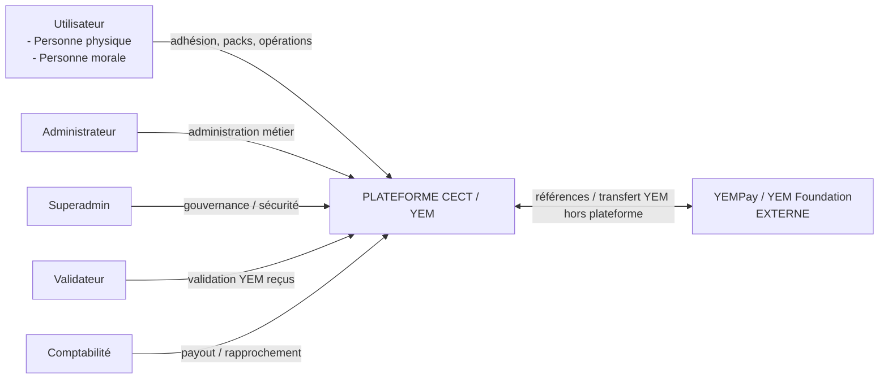

# 2. Acteurs et gouvernance

| **Acteur**              | **Nature** | **Responsabilités principales**                                                                                               | **Restrictions structurantes**                                                                   |
|-------------------------|------------|-------------------------------------------------------------------------------------------------------------------------------|--------------------------------------------------------------------------------------------------|
| Utilisateur             | Interne    | Adhérer, souscrire des packs, consommer son quota/solde, initier ventes/cessions, scanner QR marchand, suivre ses opérations. | Accès strictement limité à ses propres données et objets autorisés.                              |
| Administrateur          | Interne    | Gérer membres, catalogue de packs, contenus, paramètres métier, rapports opérationnels.                                       | Ne peut pas modifier le Superadmin, effacer l’audit ni valider arbitrairement une réception YEM. |
| Superadmin              | Interne    | Gouvernance, sécurité, RBAC, providers, paramètres critiques, comptes internes, audit global, sauvegardes.                    | Actions critiques journalisées ; MFA obligatoire.                                                |
| Validateur              | Interne    | Vérifier que les YEM déclarés ont effectivement atteint le Pernum CECT ; confirmer, rejeter ou signaler un litige.            | Ne déclenche pas manuellement un paiement hors workflow et ne peut pas modifier l’historique.    |
| Comptabilité            | Interne    | Suivre les versements dus, paiements automatiques, échecs, rapprochements, gros montants, exports et rapports.                | La validation YEM est visible mais non modifiable par Comptabilité.                              |
| YEMPay / YEM Foundation | Externe    | Exécuter les transferts YEM entre Pernum hors de la plateforme.                                                               | Aucune API officielle n’est supposée disponible en V1 sans validation explicite.                 |

## 2.1 Utilisateur : personne physique et personne morale

L’Utilisateur est le centre du fonctionnement. Une personne morale est modélisée comme une organisation distincte de la personne qui la représente. La dernière modification précise que le Pernum de la personne morale est un Pernum Business.

| **Type**          | **Données minimales**                                                                                   | **Adhésion initiale** |
|-------------------|---------------------------------------------------------------------------------------------------------|-----------------------|
| Personne physique | Nom, prénoms, Pernum, téléphone, email, mot de passe.                                                   | 25 000 FCFA           |
| Personne morale   | Raison sociale, statut juridique, gérant/représentant, Pernum Business, téléphone, email, mot de passe. | 200 000 FCFA          |

## 2.2 Permissions

Les acteurs sont peu nombreux mais les permissions backend restent fines. Les capacités métier d’un utilisateur dépendent de ses packs, non d’une multiplication de rôles.

| **Permission type**             | **Utilisateur**       | **Admin**      | **Superadmin**   | **Validateur**                | **Comptabilité**               |
|---------------------------------|-----------------------|----------------|------------------|-------------------------------|--------------------------------|
| Lire ses propres données        | Oui                   | Selon besoin   | Oui              | Limité aux dossiers à valider | Limité aux dossiers financiers |
| Créer/configurer packs          | Non                   | Oui            | Oui              | Non                           | Non                            |
| Modifier paramètres critiques   | Non                   | Restreint      | Oui              | Non                           | Non                            |
| Confirmer arrivée YEM CECT      | Non                   | Non par défaut | Exception tracée | Oui                           | Non                            |
| Déclencher paiement automatique | Indirect via workflow | Non            | Supervision      | Confirmation rend éligible    | Supervision / exceptions       |
| Gérer providers / secrets       | Non                   | Non            | Oui              | Non                           | Non                            |
| Consulter audit global          | Ses traces            | Partiel        | Oui              | Ses actions                   | Financier                      |

*Figure 2 — Séparation des tâches*

Transcription du diagramme :

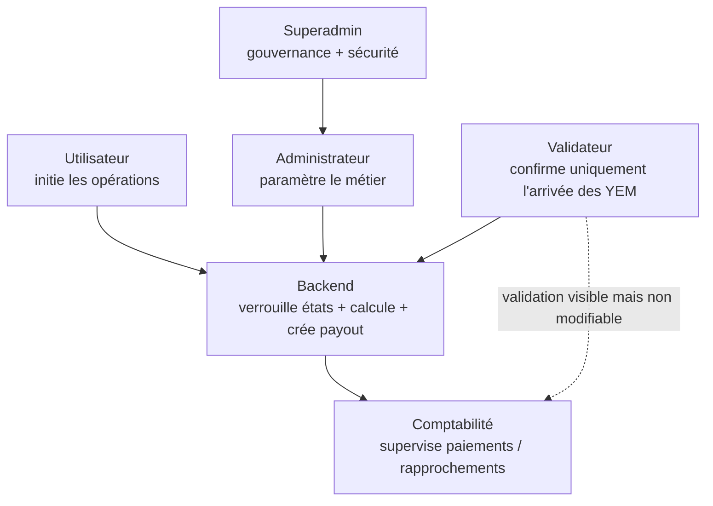

# 3. Inscription et adhésion

1.  L’utilisateur choisit personne physique ou personne morale.

2.  Le serveur valide format, unicité email et Pernum, et crée l’inscription.

3.  L’email est vérifié par un code à usage unique et durée courte.

4.  Le statut devient PENDING_PAYMENT.

5.  Le montant d’adhésion et les frais sont recalculés côté serveur.

6.  Le PSP traite le paiement ; le navigateur ne peut jamais activer un compte.

7.  Un webhook serveur authentifié et idempotent confirme le paiement ; le compte devient ACTIVE.

8.  Plusieurs tentatives de paiement peuvent viser la même inscription sans dupliquer le compte.

*Figure 3 — Inscription et activation*

Transcription du diagramme :

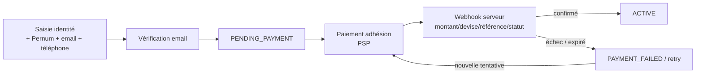

> **Mode démonstration —** Un environnement DEMO peut permettre la création de comptes sans passerelle pour valider la faisabilité. Cette activation doit être marquée DEMO_GATEWAY_BYPASS et techniquement impossible en production.

# 4. Packs et moteur de paramétrage

Les packs sont des produits configurables et versionnés. Aucun prix, quota, périodicité, taux, durée, seuil ou remise ne doit être codé en dur. Un pack acheté reste lié à sa version historique.

*Figure 4 — Familles de packs et éligibilité*

Transcription du diagramme :

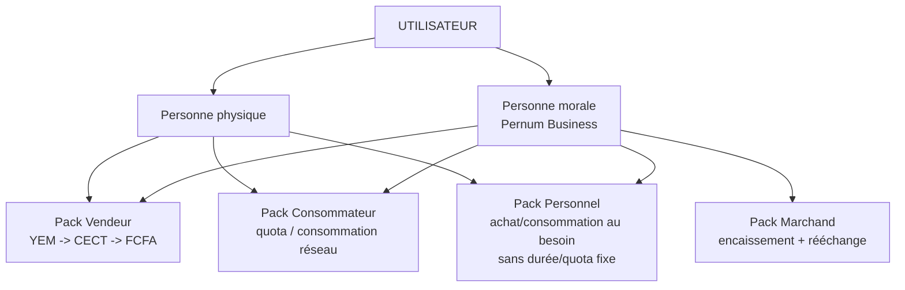

| **Famille**  | **Finalité**                                                                                     | **Règles structurantes**                                                                                              |
|--------------|--------------------------------------------------------------------------------------------------|-----------------------------------------------------------------------------------------------------------------------|
| VENDEUR      | Permet de vendre des YEM à la CECT dans une limite périodique.                                   | Quota périodique ; cumul configurable ; quantité réservée à la demande ; consommation à la confirmation YEM_RECEIVED. |
| CONSOMMATEUR | Donne un droit/volume de YEM utilisable pour des achats chez les marchands du réseau.            | Niveaux, remise, quota/période, cumul, plafond et durée configurables. Remise de travail 2-5 % à confirmer par le CA. |
| PERSONNEL    | Permet à l’adhérent d’acheter et consommer des YEM au besoin.                                    | Pas de quota fixe ni durée fixe selon la dernière modification ; ne compte pas dans la limite des 2 packs structurés. |
| MARCHAND     | Permet à une personne morale d’accepter les YEM et de demander leur rééchange auprès de la CECT. | Quota d’encaissement/rééchange et périodicité configurables ; QR marchand ; limites selon niveau.                     |

## 4.1 Limite des packs

Par défaut, un compte peut détenir au maximum deux packs structurés actifs toutes familles confondues, hors Pack Personnel. Cette limite est un paramètre de la coopérative.

## 4.2 Cycle de vie du catalogue

| **État**  | **Sens**                                                                |
|-----------|-------------------------------------------------------------------------|
| DRAFT     | Préparation, invisible au public.                                       |
| PUBLISHED | Publié et souscriptible.                                                |
| SUSPENDED | Souscription temporairement bloquée.                                    |
| RETIRED   | Retiré du catalogue ; les détenteurs existants conservent leur version. |
| ARCHIVED  | Historique uniquement.                                                  |

## 4.3 Paramètres configurables

- prix/droit d’accès

- taux achat / vente / cession

- quota par période

- périodicité et nombre de cycles

- cumul du quota

- remise consommateur

- minimum/maximum d’une opération

- délai de réservation

- réseaux/pays autorisés

- seuils et découpage des payouts

- preuves requises

- règles d’expiration

- niveaux et noms commerciaux

# 5. Tableau de bord Utilisateur

Le tableau de bord est adaptatif : il affiche des modules selon le type de personne et les packs effectivement détenus.

| **Zone**        | **Contenu attendu**                                                                  |
|-----------------|--------------------------------------------------------------------------------------|
| Identité        | Nom/raison sociale, identifiant CECT, Pernum/Pernum Business, statut compte.         |
| Mes packs       | Famille, formule, version, activation, expiration si applicable, niveau.             |
| Quota / solde   | Acquis, réservé, consommé, disponible ; cycle et compte à rebours si applicable.     |
| Actions         | Vendre mes YEM, Payer un marchand, Scanner QR, Rééchanger mes YEM selon éligibilité. |
| Transactions    | Références, contrepartie, quantité, statuts, dates, preuves et historique.           |
| Paiements reçus | Montant, moyen (T-Money/Flooz/virement/espèces), référence, état.                    |
| Documents       | Reçus, fiche d’adhésion, relevés, rapports personnels.                               |
| Notifications   | Activation, quota, demande, validation, paiement, litige, expiration.                |

*Figure 5 — Cartographie des dashboards*

Transcription du diagramme :

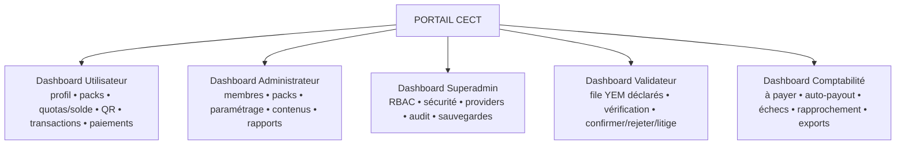

# 6. Workflows YEM

## 6.1 Pack Vendeur : Utilisateur -> CECT

Le vendeur choisit une quantité jusqu’à son disponible. La plateforme réserve cette quantité, communique le Pernum CECT (avec QR possible), puis attend le transfert réel dans YEMPay/YEM Foundation. La déclaration de l’utilisateur n’est pas une validation.

*Figure 6 — Flux Vendeur*

Transcription du diagramme :

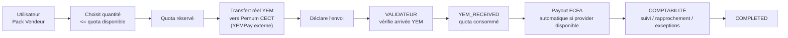

| **Étape**                        | **Effet sur quota**                           | **État clé**                     |
|----------------------------------|-----------------------------------------------|----------------------------------|
| Création demande                 | reserved += quantité                          | REQUEST_CREATED                  |
| Attente transfert                | Réservation maintenue                         | AWAITING_YEM_TRANSFER            |
| Utilisateur déclare              | Aucun débit définitif                         | USER_DECLARED_SENT               |
| Validateur confirme arrivée CECT | reserved -= quantité ; consumed += quantité   | YEM_RECEIVED                     |
| Payout                           | Quota reste consommé même si le payout échoue | COUNTERVALUE_PENDING / COMPLETED |
| Annulation avant réception       | Réservation libérée                           | CANCELLED                        |

## 6.2 Consommateur/Personnel : Utilisateur -> Marchand

L’utilisateur choisit le nombre de YEM qu’il souhaite utiliser jusqu’à son quota ou solde disponible, puis scanne le QR du marchand. Le QR identifie le marchand, son Pernum et éventuellement son point de vente. La plateforme crée une intention et réserve le montant. Le transfert YEM réel est ensuite effectué hors plateforme vers le vrai Pernum du marchand.

*Figure 7 — Flux Consommateur / Personnel vers Marchand*

Transcription du diagramme :

> **Terminologie —** Le solde/quota affiché par la plateforme est un droit suivi et comptabilisé ; il ne doit pas être présenté comme une seconde monnaie ou comme des « YEM virtuels » émis par CECT.

## 6.3 Pack Marchand : Marchand -> CECT

Après avoir encaissé des YEM de clients, le marchand voit un solde éligible au rééchange et les limites de son pack. Il demande une quantité, la plateforme la réserve, puis le marchand transfère réellement ces YEM vers le Pernum CECT. Le Validateur confirme l’arrivée ; la contre-valeur devient alors payable.

*Figure 8 — Flux de rééchange Marchand*

Transcription du diagramme :

## 6.4 QR codes

| **QR**      | **Contenu minimal**                                                 | **Effet**                                                                            |
|-------------|---------------------------------------------------------------------|--------------------------------------------------------------------------------------|
| QR CECT     | Identifiant CECT + Pernum destinataire + version QR.                | Facilite la vente/cession vers CECT ; ne prouve jamais un transfert.                 |
| QR Marchand | merchant_id + Pernum + point de vente éventuel + version/signature. | Préremplit la contrepartie d’une intention de paiement ; aucun YEM ne bouge au scan. |

# 7. Validation et Comptabilité

## 7.1 Dashboard Validateur

| **Fonction**    | **Comportement**                                                                                    |
|-----------------|-----------------------------------------------------------------------------------------------------|
| File à vérifier | Demandes déclarées envoyées vers le Pernum CECT.                                                    |
| Détails         | Référence, utilisateur/marchand, Pernum source, quantité attendue, date, éventuelle preuve.         |
| Confirmer       | Saisit/valide quantité réellement reçue ; système journalise validateur, date, preuve et référence. |
| Rejeter         | Transfert introuvable / données incohérentes ; motif obligatoire.                                   |
| Litige          | Passe le dossier en DISPUTED avec commentaires et suivi.                                            |
| Interdiction    | Ne modifie pas le bénéficiaire du payout et ne force pas la comptabilité hors workflow.             |

## 7.2 Dashboard Comptabilité

La Comptabilité dispose de la liste de tous les échanges/cessions devenus payables. La colonne « YEM confirmé » reflète la validation du Validateur ; Comptabilité ne peut pas la cocher elle-même.

| **Référence** | **Bénéficiaire** | **YEM** | **Contre-valeur** | **YEM confirmé** | **Moyen**                            | **Paiement**                           |
|---------------|------------------|---------|-------------------|------------------|--------------------------------------|----------------------------------------|
| EX-…          | Utilisateur      | …       | … FCFA            | Oui / Non        | T-Money / Flooz / Virement / Espèces | En attente / Processing / Payé / Échec |
| RD-…          | Marchand         | …       | … FCFA            | Oui / Non        | T-Money / Flooz / Virement / Espèces | En attente / Processing / Payé / Échec |

> **Règle —** La confirmation du Validateur rend le dossier éligible au paiement. Le backend crée le payout et l’envoie automatiquement au PSP lorsque la fonctionnalité de décaissement est contractuellement et techniquement activée. Sinon, le dossier bascule vers une procédure contrôlée.

# 8. Payouts et rapprochement

| **Montant dû**             | **Route initiale cible**                     |
|----------------------------|----------------------------------------------|
| <= 500 000 FCFA           | 1 envoi Mobile Money                         |
| 500 001 - 1 000 000 FCFA   | 2 envois <= seuil unitaire                  |
| 1 000 001 - 1 500 000 FCFA | 3 envois <= seuil unitaire                  |
| > 1 500 000 FCFA          | Virement bancaire ou espèces selon politique |

Tous les seuils sont configurables et doivent respecter le contrat réel du prestataire. Un payout découpé reste une seule obligation financière avec plusieurs items techniques.

*Figure 9 — Machine d’états du payout*

Transcription du diagramme :

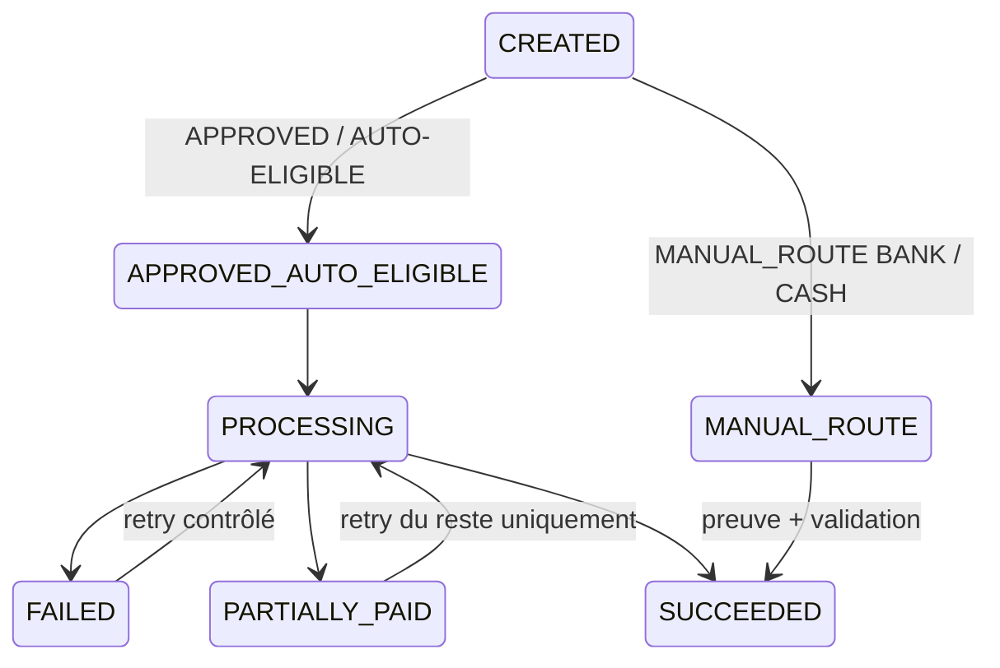

- Un échec partiel ne rejoue jamais un item déjà SUCCEEDED.

- Une validation YEM déjà acquise n’est jamais annulée à cause d’un échec du PSP.

- Les références provider, dates, montants payés et restants sont conservés.

- Banque/espèces exigent bénéficiaire identifié, auteur, seconde validation si seuil sensible, preuve et rapprochement.

# 9. Back-office et dashboards

## 9.1 Administrateur

| **Module**  | **Fonctions**                                                                              |
|-------------|--------------------------------------------------------------------------------------------|
| Membres     | Recherche, fiche complète, activation/suspension contrôlée, packs, quotas, historique.     |
| Packs       | Créer, dupliquer, versionner, publier, suspendre, retirer, archiver.                       |
| Paramétrage | Adhésions, taux, remises, limites, délais, réseaux, seuils, règles de cumul et expiration. |
| Contenus    | FAQ, actualités, partenaires, chiffres clés, annuaire marchands.                           |
| Rapports    | Filtrage et génération par période.                                                        |

## 9.2 Superadmin

| **Module**           | **Fonctions exclusives / renforcées**                                       |
|----------------------|-----------------------------------------------------------------------------|
| Comptes internes     | Créer/suspendre Admin, Validateur, Comptabilité ; gérer permissions.        |
| Sécurité             | MFA, sessions, politiques, révocations, alertes.                            |
| Providers            | Configurer PSP, secrets, environnements, webhooks, bascule.                 |
| Paramètres critiques | Pernum CECT, mode environnement, seuils sensibles, activation automatismes. |
| Audit                | Accès global, exports, revue des changements de privilèges.                 |
| Continuité           | Sauvegardes, restaurations, supervision et maintenance.                     |

# 10. Exports, imports et reporting

## 10.1 Export consolidé automatique

La modification reçue demande qu’un fichier consolidé exploitable hors plateforme soit maintenu. Pour éviter qu’une génération synchrone bloque chaque opération, l’implémentation recommandée est : après chaque transaction métier validée, publier un événement qui déclenche en arrière-plan la génération d’un snapshot consolidé versionné. La dernière version et l’historique restent téléchargeables.

| **Exigence**             | **Mesure**                                                            |
|--------------------------|-----------------------------------------------------------------------|
| Exports automatiques     | Après création/modification importante, job asynchrone de snapshot.   |
| Formats                  | Excel/CSV selon jeu de données ; PDF pour rapports.                   |
| Périmètre                | Adhésions, packs, quotas, ventes/cessions, paiements, audit autorisé. |
| Traçabilité              | snapshot_id, période, date, auteur système, hash, schéma/version.     |
| Disponibilité hors ligne | Dernier snapshot téléchargeable et archive versionnée.                |

## 10.2 Réimport hors plateforme

> **Mesure de sécurité indispensable —** Le fichier importé ne doit jamais écraser directement la base. Il passe par une zone de staging : contrôle de schéma, signature/hash, validation des identifiants, détection de conflits, aperçu du diff, autorisation Superadmin/Admin habilité, transaction atomique et audit complet.

## 10.3 Rapports

- Rapport mensuel standard.

- Rapport personnalisé avec date de début et date de fin.

- Exports PDF et Excel ; filtres identiques à ceux visibles à l’écran.

- Indicateurs : adhésions, packs actifs, YEM vendus/achetés/cédés, payouts, échecs, restes dus, marchands, volumes par période.

# 11. Modèle de données conceptuel

*Figure 10 — Modèle de domaine simplifié*

Transcription du diagramme :

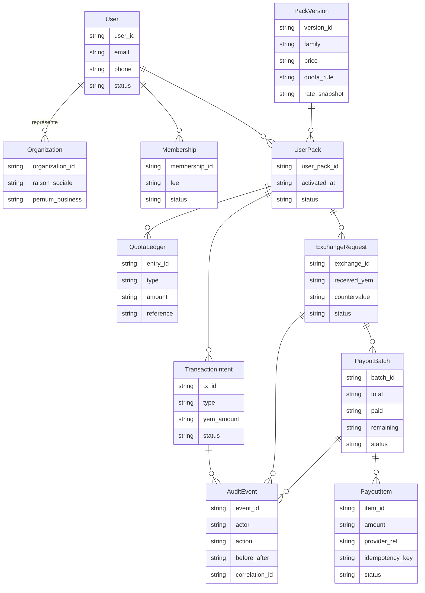

| **Entité**                          | **Attributs / responsabilité**                                                                                  |
|-------------------------------------|-----------------------------------------------------------------------------------------------------------------|
| User                                | user_id, type, identité, email, téléphone, password_hash, status.                                               |
| Organization                        | organization_id, raison_sociale, statut_juridique, Pernum Business, représentant, status.                       |
| Membership                          | membership_id, fee_snapshot, payment_status, activated_at.                                                      |
| PernumIdentity                      | pernum, owner_type, owner_id, status DECLARED/… , dispute_status.                                               |
| PackFamily / PackPlan / PackVersion | famille, niveau, version, prix, quotas, périodicité, taux/remises, règles, validité.                            |
| UserPack                            | détenteur, version achetée, prix snapshot, activation, expiration, status.                                      |
| QuotaLedger                         | crédit, réservation, libération, consommation, ajustement ; référence de l’opération.                           |
| TransactionIntent                   | paiement consommateur-marchand : QR, quantité, réservation, contrepartie, statut.                               |
| ExchangeRequest                     | vendeur/marchand vers CECT : quantité demandée/reçue, taux snapshot, contre-valeur, destination payout, statut. |
| ValidationEvidence                  | validateur, date, quantité reçue, preuve, référence externe, commentaire.                                       |
| PayoutBatch / PayoutItem            | total, route, items, provider_ref, idempotency_key, payé/restant, status.                                       |
| PaymentIntent / PaymentAttempt      | adhésion/pack, montant, frais, provider, tentatives, confirmation.                                              |
| SettingVersion                      | clé, valeur, effective_from/to, auteur, motif.                                                                  |
| AuditEvent                          | acteur, action, objet, before/after, timestamp, correlation_id, résultat.                                       |
| ExportSnapshot / ImportJob          | version, hash, fichier, statut validation, diff, auteur.                                                        |

# 12. États et règles d’intégrité

*Figure 11 — États d’un échange entrant vers CECT*

Transcription du diagramme :

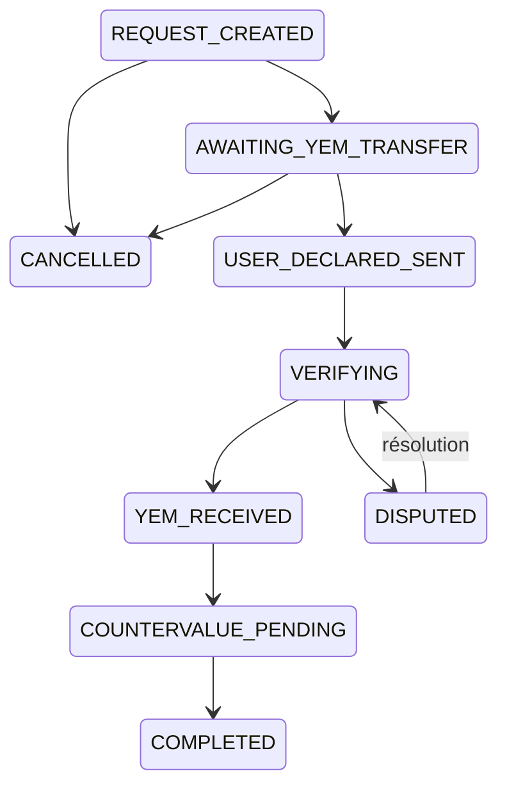

| **Invariance** | **Exigence**                                                                                              |
|----------------|-----------------------------------------------------------------------------------------------------------|
| Réservation    | available = earned/balance - reserved - consumed selon type de pack.                                      |
| Atomicité      | Contrôle du disponible + réservation doivent être transactionnels pour éviter deux demandes concurrentes. |
| Idempotence    | Webhook, activation, crédit de quota et payout disposent de clés d’idempotence.                           |
| Référence      | Références métier collision-safe (UUID/ULID ou séquence DB).                                              |
| Historique     | Toute valeur économique utilisée est snapshotée dans l’opération.                                         |
| Suppression    | Pas de hard-delete des écritures financières ; annulation/correction par événement compensatoire.         |
| Ownership      | Contrôle objet par objet ; aucun utilisateur ne lit/modifie les objets d’un autre.                        |

# 13. Architecture technique

Architecture cible issue du cahier modifié : frontend web responsive ; backend Laravel/PHP comme source de décision ; MySQL pour les données transactionnelles ; services internes découplés ; jobs asynchrones pour email, exports, webhooks et paiements. Le PSP est isolé derrière une interface afin d’être remplaçable.

*Figure 12 — Architecture logique des composants*

Transcription du diagramme :

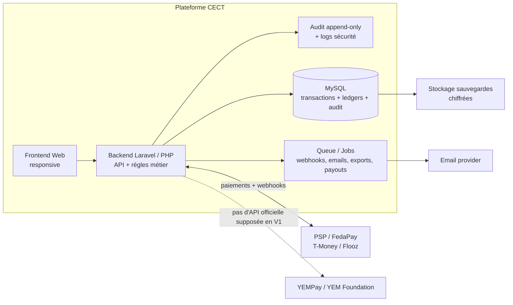

*Figure 13 — Déploiement et zones de sécurité*

Transcription du diagramme :

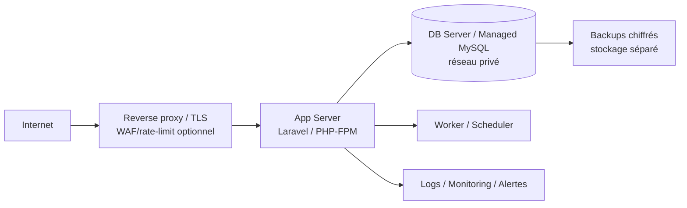

| **Composant**    | **Responsabilité**                                                                        |
|------------------|-------------------------------------------------------------------------------------------|
| Frontend         | Affichage/formulaires uniquement ; aucune décision de sécurité ou de montant faisant foi. |
| Backend          | Validation, RBAC, règles métier, transactions DB, orchestration.                          |
| MySQL            | Source transactionnelle ; contraintes uniques, transactions, historiques.                 |
| Queue/Workers    | Payouts, webhooks, notifications, exports, tâches planifiées, retries.                    |
| Provider Adapter | FedaPay initialement envisagé, mais contrat/API vérifiés avant production.                |
| Email            | OTP, activation, notifications, reçus.                                                    |
| Observabilité    | Logs structurés, métriques, traces, alertes.                                              |
| Backup           | Sauvegardes chiffrées séparées et tests de restauration.                                  |

# 14. Mesures de sécurité

| **Domaine**      | **Mesures obligatoires**                                                                                                                    |
|------------------|---------------------------------------------------------------------------------------------------------------------------------------------|
| Authentification | Argon2id, politique mot de passe, OTP email pour vérification, MFA TOTP/WebAuthn obligatoire pour Superadmin/Admin/Validateur/Comptabilité. |
| Sessions         | Cookies HttpOnly + Secure + SameSite ; rotation après login/élévation ; expiration ; révocation globale ; inventaire des sessions internes. |
| Autorisation     | RBAC backend + contrôle d’ownership objet ; deny-by-default ; moindre privilège ; séparation des tâches.                                    |
| Transport        | HTTPS/TLS partout ; HSTS en production ; redirection HTTP -> HTTPS.                                                                        |
| Web              | CSRF, CSP, X-Frame-Options/frame-ancestors, Referrer-Policy, validation serveur, encodage sortie, limites de taille.                        |
| API              | Rate limiting, schémas stricts, authentification, idempotency keys, correlation IDs, anti-replay pour webhooks.                             |
| PSP              | Secrets côté serveur uniquement ; coffre/secret manager ; signatures webhooks ; revérification montant/devise/référence/statut.             |
| Données          | Chiffrement des sauvegardes ; chiffrement des secrets ; minimisation des données ; accès DB réseau privé ; permissions DB minimales.        |
| Uploads/preuves  | Allowlist types, taille limite, nom aléatoire, stockage hors webroot, scan antimalware, pas d’exécution.                                    |
| Audit            | Journal append-only ou export immuable, before/after, acteur, IP/device selon politique, timestamp, correlation_id, résultat.               |
| Finance          | Aucune contre-valeur avant YEM_RECEIVED ; retries ciblés ; maker-checker pour gros montants/manuels ; rapprochement quotidien.              |
| DevSecOps        | Git, branches protégées, revue de code, SAST, SCA, secret scanning, tests, DAST préprod, pentest avant lancement.                           |
| Infrastructure   | Firewall, services minimaux, SSH restreint, mises à jour, fail2ban/équivalent, segmentation, monitoring.                                    |
| Continuité       | Backups quotidiens, rétention, restauration testée, plan incident, RPO/RTO définis.                                                         |

> **Objectif sécurité —** Le projet vise une réduction forte du risque et une défense en profondeur. Il ne faut pas promettre « zéro vulnérabilité » : la sécurité doit être vérifiée en continu par tests, supervision, correctifs et audits.

# 15. Logs, audit et observabilité

| **Journal**      | **Contenu**                                                                              | **Rétention/usage**                                                 |
|------------------|------------------------------------------------------------------------------------------|---------------------------------------------------------------------|
| Audit métier     | création/modification packs, paramètres, comptes, validations, payouts, imports/exports. | Long terme selon politique légale ; non modifiable par l’interface. |
| Auth/Sécurité    | login, MFA, échecs, reset, changement rôle, session révoquée, action privilégiée.        | Alerting + investigation.                                           |
| Transactions     | références, transitions d’état, réservations, validations, correlation_id.               | Rapprochement et support.                                           |
| Provider/Webhook | payload normalisé, signature valide/invalide, provider_ref, idempotency result.          | Diagnostic financier ; données sensibles masquées.                  |
| Application      | erreurs, jobs, latence, timeouts, retries.                                               | Observabilité ; jamais de mot de passe/token complet.               |
| Import/Export    | snapshot_id, hash, fichier, auteur, diff, validation, résultat.                          | Traçabilité hors ligne.                                             |

- Alertes prioritaires : échecs payout répétés, divergence de rapprochement, hausse de litiges, tentatives de login anormales, changements de privilèges, webhook signature invalide, sauvegarde échouée.

# 16. Sauvegarde et continuité

1. Sauvegarde DB automatisée quotidienne au minimum ; fréquence plus élevée selon RPO.

2. Copies chiffrées sur stockage séparé de l’application.

3. Rétention multi-générations avec protection contre suppression accidentelle/ransomware.

4. Test de restauration programmé et documenté.

5. Snapshot consolidé métier disponible pour consultation hors plateforme, sans être la source primaire de vérité.

6. Procédure d’incident : gel des payouts si incohérence critique, collecte des preuves, rapprochement, reprise contrôlée.

# 17. Stratégie de tests et recette

| **Niveau**       | **Tests**                                                                                                          |
|------------------|--------------------------------------------------------------------------------------------------------------------|
| Unitaires        | Calcul quotas, versioning, taux snapshot, routage payouts, permissions.                                            |
| Intégration      | Inscription -> webhook -> activation ; pack -> cycles ; validation -> payout ; retries.                        |
| Concurrence      | Deux demandes simultanées sur le même quota ; double webhook ; double clic.                                        |
| Sécurité         | IDOR/BOLA, CSRF, XSS, SQLi, auth, MFA, session fixation, brute force, upload, secrets.                             |
| E2E              | Parcours personne physique, personne morale, vendeur, consommateur, personnel, marchand, validateur, comptabilité. |
| Provider sandbox | Succès, refus, timeout, doublon, signature invalide, échec partiel.                                                |
| Performance      | Montée en charge, files de jobs, export volumineux, dashboard.                                                     |
| DR               | Restauration DB, reprise workers, vérification snapshots.                                                          |

# 18. Critères d’acceptation

| **ID** | **Critère**                                                                                                                    |
|--------|--------------------------------------------------------------------------------------------------------------------------------|
| AC-01  | Une personne physique ou morale peut s’inscrire, vérifier son email et entrer en PENDING_PAYMENT.                              |
| AC-02  | Deux comptes ne peuvent pas partager le même email ou Pernum applicable.                                                       |
| AC-03  | Le compte ne devient ACTIVE qu’après confirmation serveur du paiement, sauf environnement DEMO explicitement marqué.           |
| AC-04  | Les frais d’adhésion initiaux sont 25 000 FCFA (physique) et 200 000 FCFA (morale), configurables et historisés.               |
| AC-05  | La coopérative peut créer et versionner un pack sans modification du code.                                                     |
| AC-06  | Un pack déjà acheté conserve les conditions de sa version.                                                                     |
| AC-07  | La limite standard est de deux packs structurés actifs ; le Pack Personnel n’entre pas dans cette limite.                      |
| AC-08  | Le Pack Personnel permet achat/consommation au besoin tant que le solde suivi est suffisant, sans durée/quota fixe par défaut. |
| AC-09  | Une demande Vendeur/Marchand ne peut pas dépasser le disponible et réserve atomiquement la quantité.                           |
| AC-10  | La déclaration « envoyé » ne suffit pas à rendre une contre-valeur payable.                                                    |
| AC-11  | Seul le Validateur autorisé confirme l’arrivée YEM sur le compte CECT dans le workflow normal.                                 |
| AC-12  | Après YEM_RECEIVED, le quota est consommé et ne redevient pas disponible si le payout échoue.                                  |
| AC-13  | Le scan QR marchand crée une intention et identifie la contrepartie ; il n’est jamais traité comme preuve de transfert.        |
| AC-14  | Le dashboard Comptabilité affiche la validation YEM sans permettre de la falsifier/modifier.                                   |
| AC-15  | Le backend crée automatiquement le payout après validation quand le provider de décaissement est actif.                        |
| AC-16  | Un payout partiellement réussi ne rejoue que les items échoués/restants.                                                       |
| AC-17  | Les moyens de paiement affichés distinguent T-Money, Flooz, virement bancaire et espèces.                                      |
| AC-18  | Les rapports peuvent être générés pour une période libre date début/date fin.                                                  |
| AC-19  | Un snapshot consolidé versionné est généré après les mutations métier majeures.                                                |
| AC-20  | Tout import de fichier passe par staging, validation, diff, autorisation et audit ; aucun overwrite direct.                    |
| AC-21  | Toutes les actions sensibles sont corrélées et auditées avec auteur, avant/après, date et résultat.                            |
| AC-22  | Les rôles internes sensibles utilisent MFA en production.                                                                      |
| AC-23  | Les webhooks sont authentifiés, idempotents et revérifiés côté serveur.                                                        |
| AC-24  | Aucun utilisateur ne peut accéder aux données métier d’un autre par modification d’identifiant.                                |
| AC-25  | Les sauvegardes sont restaurables et un test de restauration est documenté avant mise en production.                           |

# 19. Découpage de réalisation recommandé

| **Phase**                     | **Contenu**                                                                            | **Gate de sortie**                                                   |
|-------------------------------|----------------------------------------------------------------------------------------|----------------------------------------------------------------------|
| P0 — Cadrage                  | Validation finale acteurs, packs, taux, périodicités, règles CA, provider contractuel. | Décisions ouvertes classées : ratifiées / configurables / reportées. |
| P1 — Socle                    | Identités, adhésion, paiement entrant, RBAC, audit, paramètres, sécurité de base.      | Parcours adhésion E2E + tests sécurité.                              |
| P2 — Vendeur                  | Pack Vendeur, ledger quota, demandes, Validateur, payout, Comptabilité.                | Cycle YEM -> CECT -> FCFA complet.                                 |
| P3 — Consommateur & Personnel | Quota/solde, QR marchand, intents, historique, notifications.                          | Paiement client->marchand suivi de bout en bout.                    |
| P4 — Marchand                 | Onboarding personne morale, QR, ledger encaissement, rééchange, annuaire.              | Cycle marchand->CECT->FCFA complet.                                |
| P5 — Exploitation             | Reporting, snapshots, imports contrôlés, observabilité, backups, DR.                   | Recette, restauration, monitoring et runbook validés.                |
| P6 — Production               | Hardening, pentest, DAST, revue provider, données réelles.                             | Go-live approuvé.                                                    |

# 20. Points à confirmer par le CA / gouvernance

| **ID** | **Décision à confirmer**                                                                                                         | **Pourquoi**                                                                                 |
|--------|----------------------------------------------------------------------------------------------------------------------------------|----------------------------------------------------------------------------------------------|
| PO-01  | Ratification des cours initiaux : achat 500 F/YEM, vente 650 F/YEM, cession 610 F/YEM.                                           | Le document modifié contient encore des calculs hérités de 520 F/YEM.                        |
| PO-02  | Remises exactes du Pack Consommateur par niveau (plage de travail 2-5 %).                                                        | Les anciennes tables conservent des montants calculés avec 15 % et doivent être recalculées. |
| PO-03  | Périodicité exacte Pack Marchand : « bihebdomadaire » doit être définie sans ambiguïté (deux fois/semaine ou tous les 14 jours). | Évite un comportement logiciel différent de l’intention métier.                              |
| PO-04  | Niveaux M1-M10, prix, quotas et plafonds Marchand.                                                                               | Catalogue initial non fourni complètement.                                                   |
| PO-05  | Règle du quota Vendeur restant à la fin des 12 périodes.                                                                         | Impact expiration/engagements.                                                               |
| PO-06  | Preuve exacte exigée du Validateur pour une réception YEM.                                                                       | Audit et litiges.                                                                            |
| PO-07  | Capacités contractuelles réelles FedaPay : payouts T-Money/Flooz, limites, webhooks, frais.                                      | Bloquant production automatique.                                                             |
| PO-08  | Informations et processus banque/espèces, seuils de double validation.                                                           | Gros montants.                                                                               |
| PO-09  | Frais des versements sortants : coopérative ou bénéficiaire.                                                                     | Calcul net à payer.                                                                          |
| PO-10  | Statuts juridiques et données entreprise (RCCM/NIF/documents) requis au lancement.                                               | Formulaire et conformité.                                                                    |

# Annexe A — Valeurs initiales et incohérences à recalculer

Les tableaux ci-dessous reprennent les valeurs utiles du document modifié sans masquer les incohérences introduites par les révisions. Ils servent de données de travail ; le moteur applicatif utilisera les paramètres ratifiés par le CA.

## A.1 Pack Vendeur — grille héritée

| **Formule** | **Droit d’accès (F)** | **Quota total YEM** | **Quota mensuel** | **Contre-valeur mois héritée** |
|-------------|-----------------------|---------------------|-------------------|--------------------------------|
| V1          | 100 000               | 1 500               | 125               | 65 000                         |
| V2          | 250 000               | 3 000               | 250               | 130 000                        |
| V3          | 400 000               | 6 000               | 500               | 260 000                        |
| V4          | 600 000               | 9 000               | 750               | 390 000                        |
| V5          | 800 000               | 15 000              | 1 250             | 650 000                        |
| V6          | 1 500 000             | 26 400              | 2 200             | 1 144 000                      |
| V7          | 3 000 000             | 52 800              | 4 400             | 2 288 000                      |
| V8          | 7 000 000             | 96 000              | 8 000             | 4 160 000                      |
| V9          | 15 000 000            | 180 000             | 15 000            | 7 800 000                      |
| V10         | 35 000 000            | 360 000             | 30 000            | 15 600 000                     |
| V11         | 50 000 000            | 480 000             | 40 000            | 20 800 000                     |
| V12         | 75 000 000            | 600 000             | 50 000            | 26 000 000                     |

> **Attention —** Les contre-valeurs mensuelles de cette grille correspondent encore mathématiquement à 520 F/YEM. Si le CA ratifie 500 F/YEM, elles doivent être recalculées automatiquement ; elles ne doivent pas être copiées telles quelles dans le code.

## A.2 Pack Consommateur — base de niveaux

| **Formule** | **Valeur de référence (F)** | **Remise / montant payé**                       |
|-------------|-----------------------------|-------------------------------------------------|
| C1          | 300 000                     | À recalculer après décision CA (2-5 % envisagé) |
| C2          | 500 000                     | À recalculer après décision CA (2-5 % envisagé) |
| C3          | 800 000                     | À recalculer après décision CA (2-5 % envisagé) |
| C4          | 1 000 000                   | À recalculer après décision CA (2-5 % envisagé) |
| C5          | 1 500 000                   | À recalculer après décision CA (2-5 % envisagé) |
| C6          | 2 000 000                   | À recalculer après décision CA (2-5 % envisagé) |
| C7          | 3 000 000                   | À recalculer après décision CA (2-5 % envisagé) |
| C8          | 6 000 000                   | À recalculer après décision CA (2-5 % envisagé) |

## A.3 Pack Marchand

Formules M1 à M10 prévues. Prix, quotas et périodicité exacte restent à fournir/ratifier. La plateforme doit permettre de configurer ces éléments sans déploiement logiciel.

# Annexe B — Catalogue des diagrammes

*B.1 Acteurs et systèmes externes* — même diagramme que la Figure 1 (transcription ci-dessus).

*B.2 Utilisateurs et packs* — même diagramme que la Figure 4 (transcription ci-dessus).

*B.3 Inscription et activation* — même diagramme que la Figure 3 (transcription ci-dessus).

*B.4 Flux Vendeur* — même diagramme que la Figure 6 (transcription ci-dessus).

*B.5 Flux Consommateur/Personnel -> Marchand* — même diagramme que la Figure 7 (transcription ci-dessus).

*B.6 Rééchange Marchand -> CECT* — même diagramme que la Figure 8 (transcription ci-dessus).

*B.7 Séparation des tâches* — même diagramme que la Figure 2 (transcription ci-dessus).

*B.8 États d’échange* — même diagramme que la Figure 11 (transcription ci-dessus).

*B.9 États payout* — même diagramme que la Figure 9 (transcription ci-dessus).

*B.10 Architecture composants* — même diagramme que la Figure 12 (transcription ci-dessus).

*B.11 Déploiement sécurisé* — même diagramme que la Figure 13 (transcription ci-dessus).

*B.12 Modèle de domaine* — même diagramme que la Figure 10 (transcription ci-dessus).

*B.13 Dashboards* — même diagramme que la Figure 5 (transcription ci-dessus).

# Annexe C — Glossaire

| **Terme**          | **Définition**                                                                                  |
|--------------------|-------------------------------------------------------------------------------------------------|
| Pernum             | Identifiant métier du système YEM externe.                                                      |
| Pernum Business    | Pernum associé à une personne morale/entreprise selon la dernière modification.                 |
| Quota              | Droit d’usage/échange suivi par la plateforme ; ne constitue pas une détention de YEM par CECT. |
| Réservation        | Part du quota/solde temporairement bloquée par une opération ouverte.                           |
| Ledger             | Journal de mouvements permettant de reconstruire un solde sans réécrire l’historique.           |
| Payout             | Contre-valeur FCFA due après validation d’une opération éligible.                               |
| PSP                | Prestataire de services de paiement, ex. FedaPay si capacités contractuelles validées.          |
| Validateur         | Acteur interne qui confirme l’arrivée réelle des YEM sur le compte/Pernum de la CECT.           |
| Snapshot consolidé | Export versionné des données métier pour exploitation hors plateforme.                          |

> Fin de la partie I — Le socle fonctionnel précédent est complété par la Partie II ci-après. Les points du chapitre 20 doivent être ratifiés avant de figer les paramètres économiques en production ; l’architecture doit rester configurable pour absorber ces décisions sans réécriture du code.

# PARTIE II — DOSSIER DE CONCEPTION DÉTAILLÉ

*Complément obligatoire avant reconstruction et mise en production*

Principe directeur : la plateforme impose l’intégrité technique ; la coopérative configure les règles métier. Aucun écran, API ou import ne peut contourner les invariants de sécurité, d’audit, d’idempotence et de traçabilité.

# 21. UX responsive, accessibilité et multi-écrans

L'application est conçue mobile-first et doit rester pleinement exploitable sur smartphone, tablette, ordinateur portable, écran de bureau, écran tactile et grand écran. Le comportement est fluide : aucune fonctionnalité métier ne doit être réservée à une taille d'écran précise.

*Figure 14 — Stratégie responsive et multi-écrans*

Transcription du diagramme :

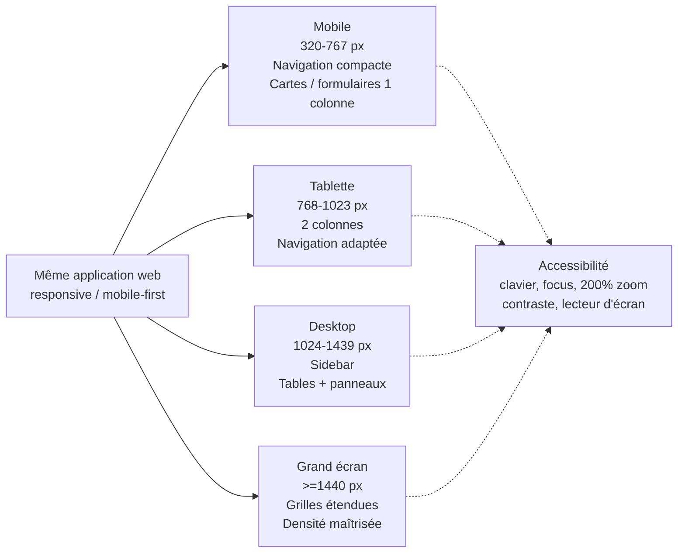

## 21.1 Plages d’affichage de référence

| **Plage**      | **Largeur CSS** | **Comportement attendu**                                                                     |
|----------------|-----------------|----------------------------------------------------------------------------------------------|
| Mobile compact | 320–479 px      | 1 colonne, actions principales visibles, navigation compacte, formulaires plein écran.       |
| Mobile         | 480–767 px      | 1 colonne dominante, cartes, QR/caméra, boutons tactiles, aucune dépendance au survol.       |
| Tablette       | 768–1023 px     | 1–2 colonnes, panneaux repliables, tableaux simplifiés ou scroll contrôlé.                   |
| Desktop        | 1024–1439 px    | Sidebar persistante, grilles 2–3 colonnes, tableaux complets, filtres visibles.              |
| Grand écran    | ≥ 1440 px       | Largeur de contenu maîtrisée, tableaux étendus, cockpit multi-panneaux sans étirer le texte. |

## 21.2 Règles d’interface non négociables

- Aucune largeur fixe bloquante : mise en page Flex/Grid fluide avec composants réutilisables.

- Aucun contenu essentiel dépend du hover ; chaque action doit fonctionner au clavier, au tactile et à la souris.

- Cibles tactiles d’au moins 44 × 44 px pour les actions essentielles ; espacement suffisant entre actions financières.

- Les formulaires passent en une colonne sur mobile ; les champs liés peuvent revenir en deux colonnes à partir de la tablette.

- Les tableaux denses utilisent priorité de colonnes, vue carte ou défilement horizontal contrôlé ; la référence et le statut restent toujours identifiables.

- Les modales deviennent des feuilles/panneaux plein écran sur mobile si le contenu est transactionnel.

- Le scan QR utilise la caméra sur mobile ; fallback obligatoire : saisie du code marchand / upload d’image / recherche du marchand.

- Les montants, statuts et erreurs ne sont jamais indiqués uniquement par une couleur.

- Les graphiques ont un résumé textuel et restent lisibles sans interaction précise.

- Portrait et paysage sont supportés ; aucune étape financière ne doit nécessiter de rotation de l’écran.

## 21.3 Cartographie responsive par dashboard

| **Espace**     | **Mobile**                                                                                   | **Desktop / grand écran**                                                   |
|----------------|----------------------------------------------------------------------------------------------|-----------------------------------------------------------------------------|
| Utilisateur    | Cartes : solde/quota, packs, transaction rapide, historique condensé.                        | Vue synthèse + packs + historique + notifications côte à côte.              |
| Validateur     | File de validations en cartes, fiche détail plein écran, boutons Confirmer/Anomalie séparés. | Table filtrable + panneau de détail + preuve/référence externe.             |
| Comptabilité   | Payouts en cartes, filtres repliables, statut/solde restant prioritaire.                     | Table financière complète, rapprochement, tentatives, exports et anomalies. |
| Administrateur | KPI essentiels, navigation par modules, formulaires de configuration séquentiels.            | Cockpit, membres, packs, paramètres, imports/exports, reporting.            |
| Superadmin     | Accès d’urgence et configuration critique avec MFA renforcée.                                | Sécurité, rôles, providers, santé plateforme, audit, configuration globale. |

## 21.4 Accessibilité

- Objectif de conception : WCAG 2.2 niveau AA pour les parcours principaux.

- Navigation complète au clavier, ordre de focus logique et focus visible.

- Labels explicites, messages d’erreur associés aux champs, annonces ARIA pour statuts asynchrones.

- Zoom texte/navigateur jusqu’à 200 % sans perte de fonctionnalité ni chevauchement.

- Contrastes suffisants ; le vert/or de la marque ne doit pas compromettre la lisibilité.

- Respect de prefers-reduced-motion ; animations décoratives non indispensables.

- Langue du document/interface déclarée ; libellés clairs en français et architecture prête à l’internationalisation.

## 21.5 Compatibilité et réseau

- Support cible : versions récentes de Chrome/Chromium, Firefox, Edge, Safari, Chrome Android et Safari iOS.

- Sur réseau instable : état de chargement explicite, reprise contrôlée, aucun double envoi lors d’un retry utilisateur.

- Une écriture financière n’est jamais validée localement/offline. Une PWA éventuelle peut mettre en cache l’interface et les contenus publics, jamais confirmer un paiement hors ligne.

- Les brouillons non financiers peuvent être conservés localement ; les opérations sensibles sont toujours recalculées et validées côté serveur.

# 22. RBAC détaillé et séparation des tâches

Les acteurs internes restent volontairement limités. Personne physique et personne morale sont des types d’Utilisateur, pas des rôles. Vendeur, Consommateur, Personnel et Marchand sont des capacités issues des packs. YEMPay/YEM Foundation est un système externe, pas un rôle interne.

| **Fonction / permission**                      | **Utilisateur**   | **Validateur**  | **Comptabilité**  | **Admin**                 | **Superadmin**               |
|------------------------------------------------|-------------------|-----------------|-------------------|---------------------------|------------------------------|
| Consulter/modifier son profil                  | ✓ propre compte   | ✓ propre compte | ✓ propre compte   | ✓                         | ✓                            |
| Souscrire / utiliser ses packs                 | ✓                 | —               | —                 | assistance                | assistance                   |
| Créer une demande Vendeur / rééchange          | ✓                 | —               | —                 | lecture/support           | ✓                            |
| Créer un paiement Consommateur -> Marchand    | ✓                 | —               | —                 | lecture/support           | ✓                            |
| Confirmer réception YEM sur compte CECT        | —                 | ✓               | lecture           | lecture                   | ✓ secours                    |
| Rejeter / mettre en anomalie une réception YEM | —                 | ✓               | lecture           | lecture                   | ✓                            |
| Modifier quantité/montant après validation     | —                 | —               | —                 | —                         | ajustement audité uniquement |
| Consulter payouts et rapprochement             | propre historique | lecture statut  | ✓                 | lecture                   | ✓                            |
| Relancer un payout provider en échec           | —                 | —               | ✓ selon politique | —                         | ✓                            |
| Enregistrer banque/espèces                     | —                 | —               | ✓                 | lecture                   | ✓ approbation si seuil       |
| Créer/modifier version de pack                 | —                 | —               | —                 | ✓                         | ✓                            |
| Publier/suspendre/retirer un pack              | —                 | —               | —                 | ✓                         | ✓                            |
| Gérer membres / suspension                     | —                 | —               | —                 | ✓                         | ✓                            |
| Gérer rôles internes                           | —                 | —               | —                 | limité, jamais Superadmin | ✓                            |
| Configurer provider/secrets                    | —                 | —               | —                 | —                         | ✓                            |
| Modifier paramètres critiques sécurité         | —                 | —               | —                 | —                         | ✓                            |
| Lire audit                                     | propre historique | périmètre       | périmètre finance | ✓ métier                  | ✓ complet                    |
| Exporter rapports                              | propres données   | périmètre       | ✓                 | ✓                         | ✓                            |

## 22.1 Invariants de séparation des tâches

- Le Validateur confirme uniquement que les YEM attendus sont arrivés sur le compte CECT ; il ne fixe pas le montant FCFA et ne marque pas un payout comme payé.

- Comptabilité ne peut pas cocher elle-même la validation YEM. La case affichée dans son tableau est la projection du statut confirmé par le Validateur.

- La confirmation YEM crée la dette FCFA et peut déclencher automatiquement le payout via le PSP lorsque la politique le permet.

- Un échec du payout ne remet jamais en cause la réception YEM déjà validée.

- Les corrections financières utilisent des ajustements compensatoires audités ; aucune suppression ou réécriture silencieuse d’un historique finalisé.

- Les opérations manuelles à risque élevé utilisent maker-checker : l’initiateur et l’approbateur ne peuvent pas être la même identité lorsque le seuil configuré l’exige.

- Un Administrateur ne peut pas se promouvoir Superadmin, modifier un Superadmin ni désactiver les contrôles de sécurité critiques.

# 23. Contrats API, QR et intégrations externes

*Figure 15 — Flux API, idempotence et provider*

Transcription du diagramme :

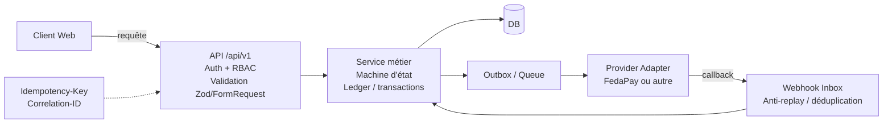

L’API est versionnée et constitue l’unique porte d’entrée des décisions métier. Les écrans ne modifient jamais directement les soldes, quotas ou statuts. Les mutations financières exigent authentification, autorisation, validation du payload, transaction base de données, clé d’idempotence et audit.

## 23.1 Conventions API

- Préfixe recommandé : /api/v1 ; version majeure explicite.

- Format JSON UTF-8 ; dates ISO-8601 ; timestamps stockés en UTC et affichés dans le fuseau de l’utilisateur/CECT.

- Montants XOF stockés en entier ; quantités YEM stockées en décimal fixe, jamais en float binaire.

- Chaque erreur renvoie un code machine stable, un message utilisateur contrôlé et correlation_id.

- Idempotency-Key obligatoire sur créations financières, validation YEM, lancement/retry de payout et imports.

- Pagination obligatoire pour toutes les listes ; filtrage et tri côté serveur.

- Contrôle d’ownership/tenant côté backend sur chaque objet, jamais seulement dans l’interface.

## 23.2 Endpoints de référence

| **Méthode** | **Route**                                   | **Usage**                                | **Acteur**                 |
|-------------|---------------------------------------------|------------------------------------------|----------------------------|
| POST        | /api/v1/auth/register                       | Créer inscription physique/morale        | Utilisateur                |
| POST        | /api/v1/auth/login                          | Authentification                         | Tous internes/utilisateurs |
| POST        | /api/v1/auth/mfa/verify                     | Second facteur                           | Rôles sensibles            |
| GET         | /api/v1/packs                               | Catalogue publié                         | Utilisateur                |
| POST        | /api/v1/pack-subscriptions                  | Souscrire un pack                        | Utilisateur                |
| GET         | /api/v1/me/quota-ledger                     | Historique quotas/solde                  | Utilisateur                |
| POST        | /api/v1/seller-exchanges                    | Demande de vente YEM à CECT              | Utilisateur                |
| POST        | /api/v1/merchant-payments/intents           | Réserver quota et initier QR             | Utilisateur                |
| POST        | /api/v1/merchant-payments/{id}/declare-sent | Déclarer transfert réel                  | Utilisateur                |
| POST        | /api/v1/merchant-redemptions                | Rééchange Marchand -> CECT              | Utilisateur moral/Marchand |
| GET         | /api/v1/validations/pending                 | File des YEM à contrôler                 | Validateur                 |
| POST        | /api/v1/validations/{id}/confirm            | Confirmer YEM reçus                      | Validateur                 |
| POST        | /api/v1/validations/{id}/dispute            | Signaler anomalie/litige                 | Validateur                 |
| GET         | /api/v1/finance/payouts                     | File financière / statuts                | Comptabilité               |
| POST        | /api/v1/finance/payouts/{id}/retry          | Relancer items échoués uniquement        | Comptabilité               |
| POST        | /api/v1/finance/manual-settlements          | Banque/espèces contrôlé                  | Comptabilité               |
| GET/POST    | /api/v1/admin/pack-plans                    | Catalogue versionné                      | Admin/Superadmin           |
| GET/PUT     | /api/v1/admin/settings/{key}                | Paramétrage versionné                    | Admin/Superadmin selon clé |
| GET         | /api/v1/admin/audit-events                  | Journal d’audit                          | Admin/Superadmin           |
| POST        | /api/v1/admin/imports                       | Prévisualiser/importer fichier consolidé | Admin/Superadmin           |
| POST        | /webhooks/payment-provider                  | Callback entrant provider                | PSP externe                |

## 23.3 QR marchand

- Le QR ne constitue jamais une preuve de paiement.

- Le QR encode de préférence un identifiant opaque/signé ou un lien CECT ; le backend résout ensuite le merchant_id, le point de vente et le Pernum courant.

- Les données critiques affichées après scan sont rechargées côté serveur ; un Pernum arbitraire présent dans un QR falsifié n’est pas accepté comme source de vérité.

- Chaque QR a version, statut actif/inactif, date de création et éventuellement outlet_id.

- Une option de révocation/rotation du QR doit exister en cas de fuite ou changement de Pernum Business.

## 23.4 Prestataires externes

- FedaPay est un provider candidat/initial ; le domaine métier dépend d’une interface PaymentProvider/PayoutProvider et non d’un SDK spécifique.

- Les capacités réelles de payout T-Money/Flooz, limites, frais, webhooks, délais et environnement production restent contractuellement à confirmer.

- YEM Foundation/YEMPay reste externe. La V1 ne suppose aucune API officielle de transfert ou de preuve tant qu’elle n’est pas effectivement disponible et autorisée.

- Toute intégration future YEM doit être ajoutée derrière un adapter sans casser les workflows manuels/validés existants.

# 24. Modèle physique, ledgers et concurrence

*Figure 16 — Ledger de quota et calcul de solde*

Transcription du diagramme :

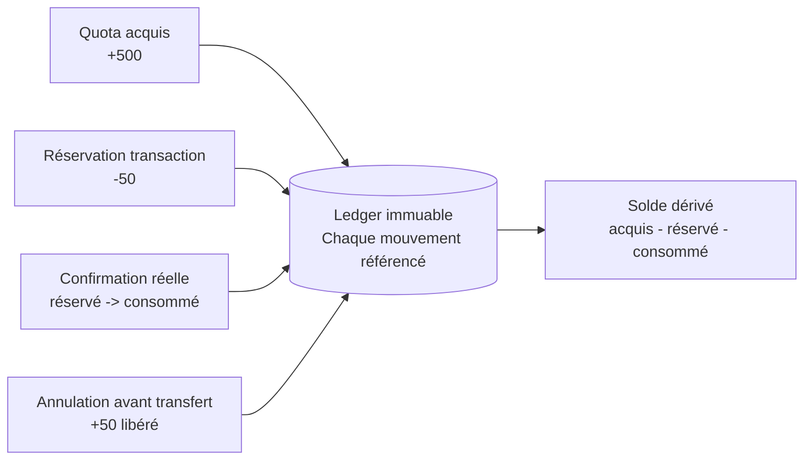

Les soldes affichés sont des projections dérivées de mouvements immuables. La plateforme ne doit pas utiliser un simple champ modifiable « balance » comme unique preuve comptable. Les écritures de ledger sont référencées à l’opération source et créées dans la même transaction que le changement d’état.

## 24.1 Tables cœur recommandées

| **Domaine**      | **Tables principales**                                                                         | **Contraintes clés**                                               |
|------------------|------------------------------------------------------------------------------------------------|--------------------------------------------------------------------|
| Identité         | users, organizations, organization_members, pernum_identities, memberships                     | email unique ; Pernum unique selon règle ; FK ; statuts contrôlés. |
| Accès            | roles, permissions, user_roles, sessions, mfa_factors                                          | rôles système protégés ; sessions hachées ; révocation.            |
| Catalogue        | pack_families, pack_plans, pack_versions, user_packs, pack_periods                             | version achetée immuable ; périodes non dupliquées.                |
| Ledger           | quota_ledger_entries, merchant_ledger_entries                                                  | référence source unique ; type ; delta ; statut ; idempotency_key. |
| Transactions YEM | exchange_requests, merchant_payment_intents, merchant_redemptions, validation_events, disputes | référence unique ; machine d’état ; snapshots Pernum/destination.  |
| Paiements        | payment_intents, payment_attempts, provider_webhook_events, payout_batches, payout_items       | event/provider ref unique ; somme items = batch ; retry ciblé.     |
| Pilotage         | settings, setting_versions, notifications, documents, export_snapshots, import_jobs            | configuration versionnée ; checksum imports/exports.               |
| Audit            | audit_events, security_events                                                                  | append-only ; correlation_id ; actor ; before/after redacted.      |

## 24.2 Principes de ledger

- Quota disponible = quota acquis − quota réservé − quota consommé.

- Création d’une demande : écriture RESERVED atomique ; annulation avant réception : RELEASED ; confirmation réelle : RESERVED -> CONSUMED.

- Le Pack Personnel possède son propre modèle de solde/achats à la demande et ne doit pas être forcé dans la logique de quota périodique si le CA confirme l’absence de quota/durée fixe.

- Le Marchand dispose d’un ledger distinct pour encaissements validés, montants réservés au rééchange et rééchanges consommés.

- Aucun DELETE sur une écriture financière ; correction par mouvement compensatoire avec motif et auteur.

- Toutes les références métier utilisent UUID/ULID ou séquence robuste ; aucune référence basée seulement sur l’heure/seconde.

## 24.3 Concurrence et double dépense

- Le contrôle du quota et la réservation sont effectués dans une transaction DB unique avec verrouillage/contrainte adaptée.

- Une même Idempotency-Key ne peut produire qu’un seul résultat métier.

- Les webhooks sont dédupliqués par provider_event_id + provider.

- Le passage d’état utilise une transition conditionnelle : une requête obsolète ne peut pas faire reculer ou rejouer une opération finalisée.

- Les workers utilisent une Outbox transactionnelle pour éviter le cas « DB validée mais message provider perdu ».

# 25. Architecture de sécurité et threat model

*Figure 17 — Frontières de confiance et composants de sécurité*

Transcription du diagramme :

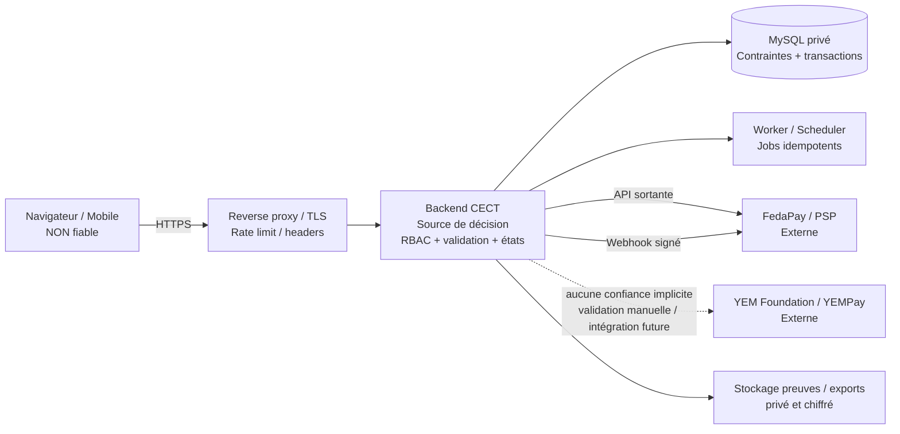

La cible n’est pas « zéro vulnérabilité », promesse irréaliste ; la cible est une architecture à défense en profondeur, contrôles compensatoires, traçabilité et capacité de détection/réponse.

## 25.1 Authentification et sessions

- Argon2id pour les mots de passe ; politique de mot de passe et blocage progressif sans révéler l’existence d’un compte.

- MFA obligatoire pour Superadmin, Administrateur, Validateur et Comptabilité ; TOTP ou WebAuthn/passkey privilégié, email OTP uniquement comme mécanisme de secours contrôlé.

- Step-up authentication pour changement de Pernum, coordonnées de payout, MFA, mot de passe, rôle ou paramètres critiques.

- Sessions serveur ou jetons courts avec révocation ; cookies Secure, HttpOnly, SameSite ; rotation après login et élévation de privilège.

- Écran de sessions actives et « déconnecter tous les appareils » pour utilisateurs et comptes internes.

## 25.2 Contrôles applicatifs

| **Menace**                       | **Contrôles obligatoires**                                                                                   |
|----------------------------------|--------------------------------------------------------------------------------------------------------------|
| IDOR / accès au compte d’autrui  | Autorisation objet par objet côté backend ; tests négatifs systématiques.                                    |
| Double dépense quota             | Ledger + transaction DB + verrouillage + idempotence.                                                        |
| Webhook rejoué/falsifié          | Signature, timestamp, anti-replay, event_id unique, revérification serveur-à-serveur si supportée.           |
| Double payout                    | Idempotency-Key provider + payout_item unique + machine d’état monotone.                                     |
| QR falsifié                      | Token signé/opaque, résolution serveur, statut QR, aucune confiance dans un Pernum brut.                     |
| XSS                              | Encodage sortie, framework auto-escape, CSP stricte, pas de HTML utilisateur non assaini.                    |
| CSRF                             | Token CSRF ou stratégie same-site adaptée à l’architecture ; Origin/Host validation sur écritures sensibles. |
| Injection SQL                    | ORM/requêtes paramétrées, validation serveur, compte DB à privilèges minimaux.                               |
| Bruteforce / credential stuffing | Rate limit par IP/compte, progressive delay, alertes, MFA.                                                   |
| Abus de privilège interne        | RBAC minimal, séparation tâches, MFA, audit, approbation sur opérations critiques.                           |
| Upload malveillant               | Allowlist type/taille, noms générés, stockage non exécutable, scan antivirus si fichiers autorisés.          |
| Fuite de secrets                 | Secrets hors Git, secret manager/env sécurisé, rotation, jamais loggés.                                      |
| Fuite via logs                   | Redaction automatique tokens/mots de passe/PII sensible ; accès logs restreint.                              |
| Altération audit                 | Journal append-only/tamper-evident, export périodique, contrôle d’accès séparé.                              |
| Déni de service                  | Rate limits, quotas requêtes, timeouts, files asynchrones, monitoring, limites d’upload/export.              |

## 25.3 Sécurité plateforme / infrastructure

- HTTPS obligatoire, TLS moderne, HSTS après validation du domaine, headers de sécurité et CSP.

- Base de données non exposée publiquement ; accès réseau privé et compte applicatif à privilèges minimaux.

- Pare-feu : seuls les ports nécessaires sont ouverts ; administration via canal restreint/VPN/Tailscale ou IP autorisées quand possible.

- Séparation stricte DEV/STAGING/PROD et secrets différents par environnement.

- SAST, scan dépendances, secret scanning, DAST en staging et pentest avant production puis périodiquement.

- Mises à jour de sécurité et dépendances suivies ; SBOM conservée par release.

- Sauvegardes chiffrées, clés séparées, tests de restauration.

## 25.4 Changements sensibles

- Changement de numéro de payout, Pernum Business, email principal ou coordonnées bancaires : MFA + notification + historique + éventuel délai de sécurité configurable.

- Changement de taux, seuils, frais, pack ou provider : création d’une version de configuration, motif obligatoire, auteur, date d’effet.

- Aucun secret provider n’est affiché en clair après enregistrement ; l’interface montre seulement un masque et l’état de configuration.

# 26. Observabilité, alertes et supervision

*Figure 18 — Logs, métriques, audit et alertes*

Transcription du diagramme :

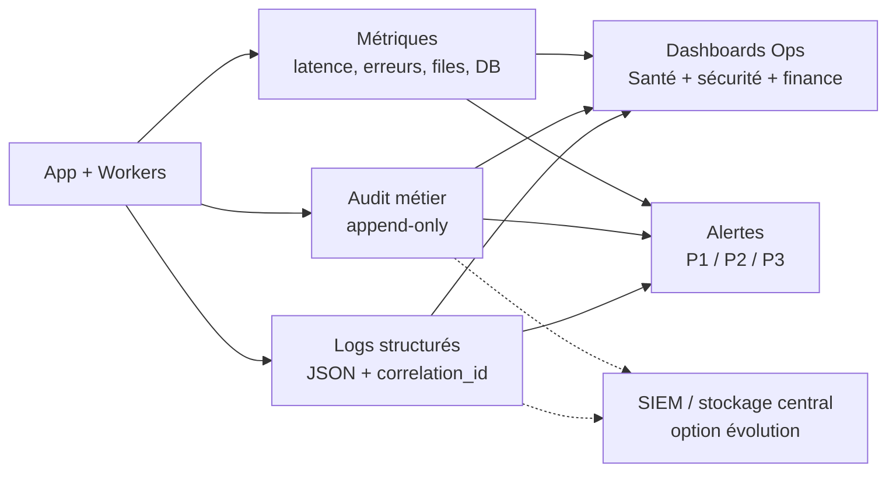

## 26.1 Trois journaux distincts

| **Flux**            | **Contenu**                                                                            | **Exclusions**                                   |
|---------------------|----------------------------------------------------------------------------------------|--------------------------------------------------|
| Logs applicatifs    | requête, route, durée, statut, correlation_id, erreurs techniques                      | mots de passe, tokens, secrets, données inutiles |
| Audit métier        | acteur, action, objet, before/after redacted, résultat, timestamp, raison              | aucune donnée secrète brute                      |
| Événements sécurité | login échec/succès, MFA, changement rôle, session révoquée, signature webhook invalide | pas de secret/authenticator seed                 |

## 26.2 Métriques minimales

- HTTP : débit, p50/p95/p99, taux 4xx/5xx, endpoints les plus lents.

- DB : connexions, latence, verrous, erreurs, espace disque, réplication/backup age.

- Jobs : queue depth, âge du plus vieux job, retries, dead-letter jobs.

- Finance : payouts créés/réussis/échoués/partiels, montant restant dû, temps de règlement.

- YEM : demandes en attente validation, délai moyen validation, litiges, écarts attendu/reçu.

- Sécurité : échecs login, MFA, changements de rôle, webhooks invalides, rate-limit hits.

- Intégrité : divergence ledger/balance dérivée = alerte immédiate.

## 26.3 Alertes

| **Sévérité**   | **Exemples**                                                                                                          |
|----------------|-----------------------------------------------------------------------------------------------------------------------|
| P1 critique    | ledger incohérent, double payout suspecté, DB indisponible, perte d’intégrité, faille active, backup inutilisable.    |
| P2 majeure     | hausse forte des payouts en échec, provider indisponible, queue bloquée, disque > seuil, webhook rejeté massivement. |
| P3 information | backup terminé, certificat proche expiration, dépendance à mettre à jour, rapport généré.                             |

# 27. Sauvegardes, continuité et PRA

*Figure 19 — Sauvegarde, restauration et PRA*

Transcription du diagramme :

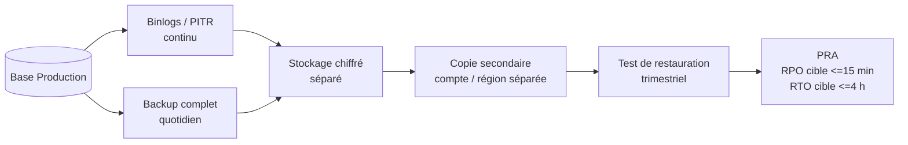

Objectifs proposés à ratifier : RPO ≤ 15 minutes et RTO ≤ 4 heures pour les données transactionnelles critiques. Ces valeurs sont des cibles de conception, à ajuster selon budget, hébergeur et engagement de service.

- Stratégie 3-2-1 : plusieurs copies, au moins deux supports/logiques, une copie séparée du serveur de production.

- MySQL : sauvegardes complètes quotidiennes + journaux/binlogs pour point-in-time recovery lorsque l’hébergement le permet.

- Sauvegarde également des preuves/documents, configurations non secrètes, métadonnées QR et exports importants.

- Secrets/clé de chiffrement sauvegardés dans un mécanisme séparé et contrôlé, pas dans l’archive applicative en clair.

- Restauration testée au moins trimestriellement sur environnement isolé avec compte-rendu.

- Aucun backup n’est considéré valide uniquement parce que le job a réussi : vérification intégrité + test réel périodique.

- Runbook de bascule et communication en cas d’indisponibilité prolongée.

# 28. Environnements, CI/CD et déploiements

*Figure 20 — Chaîne CI/CD et promotion vers production*

Transcription du diagramme :

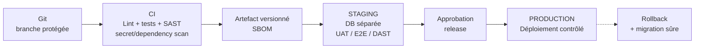

| **Environnement** | **Usage**                                        | **Règles**                                                                 |
|-------------------|--------------------------------------------------|----------------------------------------------------------------------------|
| DEV               | Développement local/intégration                  | Données synthétiques, clés sandbox uniquement.                             |
| STAGING           | Recette, E2E, DAST, intégration provider sandbox | Configuration proche PROD, aucune donnée réelle copiée sans anonymisation. |
| PRODUCTION        | Service réel                                     | Accès restreint, MFA, secrets production, monitoring/backup obligatoires.  |

- Git avec branche principale protégée et revue de code pour les changements sensibles.

- Pipeline : lint -> tests unitaires -> tests intégration -> SAST/secret/dependency scan -> build -> artefact/SBOM -> staging -> UAT/DAST -> approbation -> production.

- Migrations DB versionnées ; migration destructive interdite sans stratégie de compatibilité/rollback et sauvegarde préalable.

- Chaque release porte un identifiant/version visible dans les logs et le dashboard Superadmin.

- Rollback documenté ; les jobs financiers en cours conservent leur idempotence lors d’un redéploiement.

# 29. Performance, capacité et disponibilité

| **Objectif**     | **Cible de conception**                                                                                                             |
|------------------|-------------------------------------------------------------------------------------------------------------------------------------|
| Interface        | Chargement initial optimisé sur réseau mobile ; pages publiques et dashboards sans bundles inutiles.                                |
| API interne      | p95 < 500 ms pour les opérations sans dépendance externe, à mesurer en staging/prod.                                               |
| Provider externe | Traitement asynchrone ; l’utilisateur voit un statut plutôt qu’un écran bloqué pendant un appel long.                               |
| Listes           | Pagination serveur, recherche indexée, jamais de chargement de millions de lignes côté navigateur.                                  |
| Exports          | Génération asynchrone pour gros volumes, fichier signé/checksum, notification lorsqu’il est prêt.                                   |
| Scalabilité      | Backend stateless autant que possible ; workers séparables ; cache uniquement pour données non critiques ou invalidation maîtrisée. |
| Disponibilité    | Objectif initial proposé ≥ 99,5 % hors maintenance planifiée ; à ratifier contractuellement.                                        |
| Base de données  | Index sur références, statuts, dates, user_id/organization_id, provider_reference ; analyse des requêtes lentes.                    |

## 29.1 Résilience des dépendances

- Timeouts explicites, retries avec backoff uniquement sur opérations sûres/idempotentes.

- Circuit breaker ou suspension temporaire des appels si le provider échoue massivement.

- Aucune perte d’état si FedaPay/YEMPay est indisponible : l’opération reste PENDING/FAILED_RETRYABLE et est visible en Comptabilité.

- Dead-letter queue pour jobs qui dépassent la politique de retry ; traitement manuel audité.

# 30. Gouvernance des données et confidentialité

| **Classe**   | **Exemples**                                             | **Traitement**                                              |
|--------------|----------------------------------------------------------|-------------------------------------------------------------|
| Public       | site, FAQ, catalogue publié                              | cache/CDN possible, aucun secret.                           |
| Interne      | paramétrage non sensible, statistiques agrégées          | accès personnel autorisé.                                   |
| Confidentiel | identité, téléphone, email, Pernum, historique financier | RBAC, chiffrement transport/backup, accès journalisé.       |
| Secret       | clés PSP, tokens, MFA seeds, mots de passe               | secret manager, jamais exporté/loggé, accès très restreint. |

- Minimisation : ne collecter que les données nécessaires aux finalités définies.

- Rétention : politique formelle validée par la coopérative et le conseil juridique ; audit/finance ne sont pas supprimés arbitrairement.

- Exports utilisateurs/admin soumis aux mêmes autorisations que les écrans ; les fichiers sensibles ont expiration d’accès et journalisation.

- L’import/export consolidé ne doit pas devenir une base parallèle non contrôlée : chaque export porte version, checksum, date, périmètre et auteur.

- Import : validation schéma -> prévisualisation diff -> détection conflits -> approbation -> transaction -> audit -> rapport d’import. Jamais de UPDATE aveugle depuis Excel.

- Les données production ne sont pas utilisées telles quelles dans DEV/STAGING ; anonymisation ou données synthétiques.

# 31. Stratégie de tests complète

| **Type**       | **Couverture minimale**                                                                           |
|----------------|---------------------------------------------------------------------------------------------------|
| Unitaires      | calcul quota, transitions, routage payout, versioning, permissions, validations.                  |
| Intégration DB | transactions, contraintes, migrations, ledger, idempotence, concurrence.                          |
| API            | auth, RBAC, ownership, validation schéma, erreurs, pagination, idempotency.                       |
| E2E            | inscription, achat pack, vendeur, paiement QR, rééchange marchand, validation, payout, reporting. |
| Concurrence    | deux demandes simultanées sur même quota ; deux webhooks ; deux retries payout.                   |
| Provider       | sandbox + simulateur pannes/timeouts/doublons/ordre inversé de webhooks.                          |
| Sécurité       | SAST, dépendances, secrets, DAST, tests IDOR/CSRF/XSS/injection/session/RBAC.                     |
| Responsive     | 320 px à grand écran, portrait/paysage, tactile/clavier, tableaux, modales, QR.                   |
| Accessibilité  | clavier, focus, contraste, labels, lecteur écran, zoom 200 %.                                     |
| Charge         | pics inscription, dashboards, exports, file validations/payouts.                                  |
| PRA            | restauration DB/documents et reprise jobs sans double paiement.                                   |
| UAT            | scénarios signés par la coopérative avant go-live.                                                |

## 31.1 Invariants à tester systématiquement

- Jamais de quota négatif.

- Jamais de consommation supérieure au quota disponible + règles autorisées.

- Une confirmation YEM finalisée ne peut pas être rejouée.

- Un payout item SUCCEEDED n’est jamais renvoyé lors d’un retry.

- La somme paid_amount + remaining_amount = total_amount du batch.

- Une modification de PackVersion n’altère jamais un UserPack déjà acheté.

- Aucune API ne retourne les données d’un autre utilisateur sans permission explicite.

- Un changement de paramètre prend effet à la date/version prévue et l’historique reste reproductible.

# 32. Exploitation, runbooks et gestion des incidents

| **Incident**              | **Runbook attendu**                                                                                               |
|---------------------------|-------------------------------------------------------------------------------------------------------------------|
| FedaPay/PSP indisponible  | suspendre nouveaux appels si nécessaire, conserver dettes, file retry, informer Comptabilité, aucun double envoi. |
| YEM externe indisponible  | empêcher confirmation non vérifiée, conserver demandes, informer Validateur.                                      |
| Payout partiellement payé | figer items réussis, recalculer reste dû, retry des FAILED uniquement.                                            |
| Webhook dupliqué          | déduplication et réponse idempotente, audit du duplicate.                                                         |
| DB indisponible/corrompue | mode maintenance, restauration/bascule, vérification ledgers avant reprise.                                       |
| Compte interne compromis  | révoquer sessions, désactiver compte, rotation secrets si besoin, audit actions, incident sécurité.               |
| Perte MFA                 | procédure de récupération forte, jamais simple email pour Superadmin sans contrôle secondaire.                    |
| QR marchand compromis     | révoquer/rotater QR, conserver historique, informer marchand.                                                     |
| Import erroné             | rollback transactionnel si non finalisé ; sinon import compensatoire/versionné, rapport et audit.                 |
| Suspicion double paiement | bloquer payout concerné, rapprochement provider, escalade P1, ne pas supprimer les traces.                        |

## 32.1 Gestion des incidents

- Niveaux P1/P2/P3 avec responsable, canal d’escalade et délai de prise en charge.

- Chronologie d’incident, décisions, preuves et actions de correction conservées.

- Post-mortem pour incident majeur : cause racine, impact, détection, correction, prévention, propriétaire et échéance.

- Procédure de communication aux utilisateurs/coopérative lorsque l’incident affecte des paiements ou des soldes.

# 33. Checklist de mise en production

| **Domaine** | **Condition de GO**                                                                                     |
|-------------|---------------------------------------------------------------------------------------------------------|
| Métier      | taux/remises/packs/périodicités validés ; points bloquants CA clôturés ou explicitement hors périmètre. |
| Provider    | contrat production, clés, webhooks, limites, réseaux, frais, procédures d’échec testés.                 |
| Sécurité    | MFA rôles sensibles, TLS, secrets prod, RBAC, pentest/DAST, vulnérabilités critiques corrigées.         |
| Données     | migrations validées, sauvegarde initiale, restauration testée, règles rétention approuvées.             |
| Finance     | idempotence, partial failure, rapprochement, banque/espèces, seuils et maker-checker testés.            |
| Responsive  | recette mobile/tablette/desktop/grand écran + navigateurs cibles + accessibilité.                       |
| Ops         | monitoring, alertes, runbooks, contacts d’escalade, certificats, capacité disque/DB.                    |
| Qualité     | tests unit/intégration/E2E/concurrence/charge/UAT au vert.                                              |
| Gouvernance | comptes Superadmin/Admin/Validateur/Comptabilité nominatifs, aucun compte partagé.                      |
| Mode démo   | tous bypass et credentials de démonstration désactivés en production.                                   |

## 33.1 Critères responsive supplémentaires

- AC-RWD-01 : aucune page métier n’a de scroll horizontal global à 320 px ; seules les zones de données explicitement prévues peuvent défiler horizontalement.

- AC-RWD-02 : les actions financières restent utilisables au tactile sans zoom.

- AC-RWD-03 : à 200 % de zoom, aucune information ou action essentielle n’est masquée.

- AC-RWD-04 : les tableaux Validateur/Comptabilité ont une alternative mobile exploitable.

- AC-RWD-05 : le parcours QR fonctionne sur caméra mobile et dispose d’un fallback sans caméra.

- AC-RWD-06 : toutes les fonctionnalités peuvent être réalisées au clavier sur desktop.

# 34. Décisions encore ouvertes

Ces sujets doivent rester visibles dans le backlog de gouvernance ; ils ne doivent pas être transformés en constantes cachées par le développement.

| **Sujet**          | **Décision à obtenir**                                               | **Impact**                         |
|--------------------|----------------------------------------------------------------------|------------------------------------|
| Économie YEM       | taux achat/vente/cession, remises, frais et règles de rentabilité    | calculs, packs, payouts, reporting |
| Pack Personnel     | règles exactes d’achat/livraison/solde et relation avec Consommateur | modèle ledger et dashboard         |
| Pack Marchand      | bihebdomadaire vs autre périodicité, niveaux M1–M10, plafonds        | catalogue et cycles                |
| Quota fin de durée | expiration, grâce, maintien, migration                               | ledger et état UserPack            |
| Preuve YEM         | référence/capture/données externes exigées au Validateur             | validation et audit                |
| PSP                | capacités réelles payout, limites T-Money/Flooz, frais, sandbox/prod | automatisation finance             |
| Banque/espèces     | coordonnées, seuils, approbateurs, preuve de réception               | payout manuel                      |
| Personne morale    | liste statuts juridiques, RCCM/NIF/documents au lancement            | inscription/KYC métier             |
| Rétention          | durée légale/opérationnelle par type de données                      | privacy, audit, stockage           |
| SLO/RPO/RTO        | objectifs contractuels et budget infrastructure                      | architecture production            |

# Annexe D — Diagrammes de conception technique complémentaires

Les figures suivantes complètent les diagrammes métier de la Partie I et constituent la base de la reconstruction technique.

*D.1 Responsive et multi-écrans* — même diagramme que la Figure 14 (transcription ci-dessus).

*D.2 Frontières de confiance* — même diagramme que la Figure 17 (transcription ci-dessus).

*D.3 API, idempotence et provider* — même diagramme que la Figure 15 (transcription ci-dessus).

*D.4 Observabilité et alertes* — même diagramme que la Figure 18 (transcription ci-dessus).

*D.5 Sauvegarde et PRA* — même diagramme que la Figure 19 (transcription ci-dessus).

*D.6 CI/CD et environnements* — même diagramme que la Figure 20 (transcription ci-dessus).

*D.7 Ledgers et solde dérivé* — même diagramme que la Figure 16 (transcription ci-dessus).
